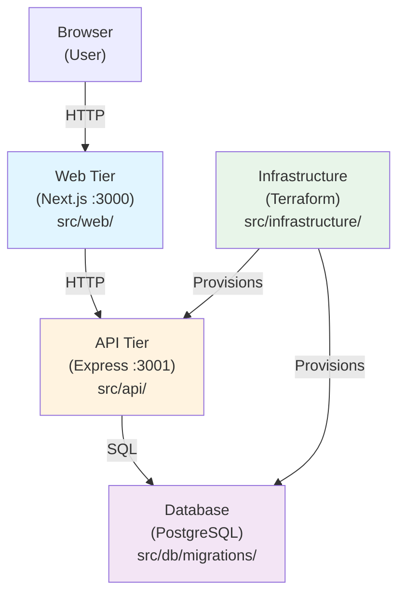

# AI-Assisted Development

_Generated by Forge from `main` at `9e9f20c`._

# AI-Assisted Development

This three-tier application is designed to work well with Claude Code and other AI agents. The clear separation between frontend, API, and database layers makes it easier for AI to reason about changes, and the Docker-based local environment allows agents to run and test code in isolation. This page covers best practices for using Claude Code and AI-assisted development with this codebase.

## Getting Started with Claude Code

Claude Code is a CLI tool that can read your codebase, run commands, edit files, and reason about multi-file changes. Install it and open this repository:

```bash
npm install -g @anthropic-ai/claude-code
cd three-tier-application-demo
claude
```

Claude Code reads the project structure automatically and works best when you give it specific, scoped tasks rather than broad ones. It can execute `docker compose up`, inspect logs, and make changes across multiple files.

## Suggested Prompts by Task

### Understanding the Codebase

Use these prompts to get oriented:

- "Explain how a task flows from the browser through the web tier, to the API, and into the database."
- "What tables exist in the database and what are their schemas?"
- "Walk me through what happens when `docker compose up` runs, in order."
- "Show me all the migrations that have been applied and what schema they created."

### Adding Features

For feature development, be specific about the scope and expected behavior:

- "Add a DELETE /tasks/:id endpoint to the API and wire it up to a delete button in the frontend."
- "Add a due_date column to the tasks table. Create the migration, update the API to accept and return it, and show it in the UI."
- "Add input validation to the POST /tasks endpoint so that titles longer than 200 characters are rejected with a 422 status."

### Database Migrations

Migrations are a natural place to start when adding features:

- "Create a node-pg-migrate migration that adds a priority column (integer, default 0) to the tasks table."
- "Show me all the migrations that have been applied and what schema they created."

### Docker and Infrastructure

For operational tasks:

- "The migrate service keeps restarting. Read the Dockerfile and docker-compose.yml and tell me why."
- "Add a .env.example file documenting all environment variables used across the three services."
- "Explain the Terraform in src/infrastructure/ and what GCP resources it creates."

### Code Review and Cleanup

Ask Claude to audit for common issues:

- "Review the API's error handling. Are there cases where the server could crash or return an unhelpful error?"
- "Is there any N+1 query risk in the API? Check all database calls."
- "Run docker compose up and tell me what errors appear in the logs."

## Best Practices for AI-Assisted Development

### Give Context, Not Just Commands

Instead of:
> "Fix the bug"

Try:
> "The PATCH /tasks/:id endpoint returns 200 even when the id doesn't exist. Fix it to return 404."

Telling Claude which endpoint, file, or layer you're working on saves a round-trip and reduces hallucination.

### Scope Changes to One Tier at a Time

Three-tier apps have natural seams at each layer boundary. When adding a feature, ask Claude to work on one layer at a time and verify each before moving on:

1. **Migration first** — get the schema right in `src/db/migrations/`
2. **API next** — add the endpoint in `src/api/index.js` and test it with curl
3. **Frontend last** — wire up the UI in `src/web/app/`

This approach reduces the risk of cascading errors and makes it easier to debug.

### Let Claude Run the App

Claude Code can execute `docker compose up` and observe logs. If something breaks at runtime:

```
Run docker compose up and tell me what errors appear in the logs.
```

This is much faster than trying to reason about the code without seeing actual behavior.

### Use It to Write One-Off Scripts

For tasks like seeding data or inspecting the database:

```
Write a script that seeds the tasks table with 10 sample tasks using the API's POST /tasks endpoint.
```

### Ask for Explanations Before Risky Changes

Before a risky change (schema migration, refactor, authentication), ask Claude to explain its plan first:

```
Before you make any changes, explain your plan for adding user authentication to this app.
```

This gives you a chance to catch issues before they're implemented.

## Project-Specific Conventions

When working with Claude Code on this repo, keep these conventions in mind:

| Convention | Details |
|-----------|---------|
| **Migrations are append-only** | Never edit an existing migration file; create a new one. This ensures consistency across environments. |
| **The API is internal** | The API (`src/api/`) is not exposed outside the Docker network; all external traffic goes through the web tier (`src/web/`). |
| **Environment variables are the config boundary** | Connection strings, ports, and URLs are all passed via env vars. No hardcoded values. |
| **Node 22 / PostgreSQL 17** | Match these versions in any new Dockerfiles or dependencies. |
| **Next.js 16 / React 19** | The web tier uses recent versions; check `src/web/AGENTS.md` for breaking changes. |

## Architecture for AI Reasoning



When asking Claude to make changes, reference this flow. For example:
- "Update the web tier to call the new endpoint" (layer B)
- "Add the endpoint to the API" (layer C)
- "Create a migration for the new column" (layer D)

## Common Workflows

### Adding a New Task Property

1. Ask Claude to create a migration: `"Create a migration that adds a status column (varchar, default 'pending') to the tasks table."`
2. Ask Claude to update the API: `"Update the POST and PATCH /tasks endpoints to accept and return the status field."`
3. Ask Claude to update the UI: `"Add a status dropdown to the task form in the web tier."`
4. Ask Claude to test: `"Run docker compose up and verify the new field works end-to-end."`

### Debugging a Runtime Error

1. Ask Claude to run the app: `"Run docker compose up and show me the full logs."`
2. Ask Claude to find the issue: `"The API is crashing with 'Cannot read property X'. Find where this happens and explain why."`
3. Ask Claude to fix it: `"Fix the error by adding a null check."`
4. Ask Claude to verify: `"Run docker compose up again and confirm the error is gone."`

### Deploying to GCP

1. Ask Claude to explain the Terraform: `"Explain what src/infrastructure/main.tf does and what GCP resources it creates."`
2. Ask Claude to prepare variables: `"Create a terraform.tfvars file with the required variables for deploying to my GCP project."`
3. Ask Claude to plan the deployment: `"Run terraform plan and show me what resources will be created."`
4. Ask Claude to apply: `"Run terraform apply to deploy the app."`

## Limitations and Caveats

- **Claude Code works best with small, focused tasks.** Asking it to "rebuild the entire app" is less effective than breaking it into steps.
- **Always review generated migrations.** Schema changes are hard to undo; make sure the migration is correct before applying it.
- **Test locally first.** Use `docker compose up` to verify changes work before deploying to GCP.
- **Secrets and credentials.** Never ask Claude to hardcode secrets; always use environment variables and Secret Manager.
- **Next.js breaking changes.** The web tier uses Next.js 16, which may differ from Claude's training data. Refer to `src/web/AGENTS.md` for warnings.

## Sources
- `agents.md`
- `src/web/AGENTS.md`
- `src/web/CLAUDE.md`
- `README.md`
