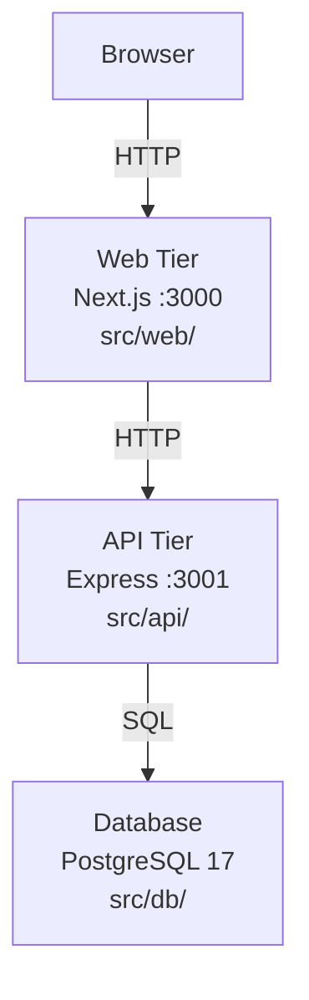

# AI-Assisted Development

_Generated by Forge from `main` at `9e9f20c`._

# AI-Assisted Development

This project is designed to be understood and extended using Claude Code and AI agents. The codebase includes conventions and documentation to help AI tools reason about the three-tier architecture, make multi-file changes safely, and suggest improvements. This guide covers how to use Claude Code effectively with this application, patterns for AI-assisted development on three-tier apps, and project-specific conventions that make AI collaboration smoother.

## Getting Started with Claude Code

Claude Code is a CLI tool that can read your codebase, run commands, edit files, and reason about multi-file changes. Install it and open this repository:

```bash
npm install -g @anthropic-ai/claude-code
cd three-tier-application-demo
claude
```

Claude Code reads the project structure automatically and works best when you give it specific, scoped tasks rather than broad ones. For example, instead of "improve the API," try "add a DELETE /tasks/:id endpoint and wire it to a delete button in the frontend."

## Common Tasks and Suggested Prompts

### Understanding the Codebase

Use these prompts to explore how the application works:

- `Explain how a task flows from the browser through the web tier, to the API, and into the database.`
- `What tables exist in the database and what are their schemas?`
- `Walk me through what happens when docker compose up runs, in order.`

### Adding Features

For feature development, scope your requests to one tier at a time:

- `Add a DELETE /tasks/:id endpoint to the API and wire it up to a delete button in the frontend.`
- `Add a due_date column to the tasks table. Create the migration, update the API to accept and return it, and show it in the UI.`
- `Add input validation to the POST /tasks endpoint so that titles longer than 200 characters are rejected with a 422 status.`

### Database Migrations

Migrations are managed by node-pg-migrate and live in `src/db/migrations/`:

- `Create a node-pg-migrate migration that adds a priority column (integer, default 0) to the tasks table.`
- `Show me all the migrations that have been applied and what schema they created.`

### Docker and Infrastructure

For deployment and infrastructure questions:

- `The migrate service keeps restarting. Read the Dockerfile and docker-compose.yml and tell me why.`
- `Add a .env.example file documenting all environment variables used across the three services.`
- `Explain the Terraform in src/infrastructure/ and what GCP resources it creates.`

### Code Review and Cleanup

Use AI to audit code quality:

- `Review the API's error handling. Are there cases where the server could crash or return an unhelpful error?`
- `Is there any N+1 query risk in the API? Check all database calls.`

## Best Practices for AI-Assisted Development

### Give Context, Not Just Commands

Instead of:
> "Fix the bug"

Try:
> "The PATCH /tasks/:id endpoint returns 200 even when the id doesn't exist. Fix it to return 404."

Claude Code can find the relevant file, but telling it which endpoint and what the expected behavior is saves a round-trip and produces better results.

### Scope Changes to One Tier at a Time

Three-tier apps have natural seams at each layer boundary. When adding a feature, ask Claude to work on one layer at a time and verify each before moving on:

1. **Migration first** — get the schema right
2. **API next** — add the endpoint and test it with curl
3. **Frontend last** — wire up the UI

This approach reduces the risk of cascading failures and makes it easier to debug issues.

### Let Claude Run the App

Claude Code can execute `docker compose up` and observe logs. If something breaks at runtime, ask:

```
Run docker compose up and tell me what errors appear in the logs.
```

This is especially useful for catching runtime errors that static analysis might miss.

### Use It to Write One-Off Scripts

For tasks like seeding data or inspecting the database:

```
Write a script that seeds the tasks table with 10 sample tasks using the API's POST /tasks endpoint.
```

### Ask for Explanations Before Changes

Before a risky change (schema migration, refactor), ask Claude to explain its plan:

```
Before you make any changes, explain your plan for adding user authentication to this app.
```

This gives you a chance to review the approach and catch issues early.

## Project-Specific Conventions

These conventions help AI tools (and humans) work safely with the codebase:

| Convention | Details |
|-----------|---------|
| **Migrations are append-only** | Never edit an existing migration file; create a new one. This ensures consistency across environments. |
| **The API is internal** | The API is not exposed outside the Docker network; all external traffic goes through the web tier (`src/web/`). |
| **Environment variables are the config boundary** | Connection strings, ports, and URLs are all passed via env vars. No hardcoded values. |
| **Node 22 / PostgreSQL 17** | Match these versions in any new Dockerfiles or dependencies. |
| **Next.js version specifics** | See `src/web/AGENTS.md` — this version may have breaking changes from your training data. |

## Architecture Overview for AI Agents

The application follows a classic three-tier pattern:



- **Frontend** (`src/web/`) — Next.js 16 with React 19 and Tailwind CSS. Handles all user interaction and calls the API.
- **API** (`src/api/`) — Express 5 REST API. Validates requests, queries the database, and returns JSON.
- **Database** (`src/db/`) — PostgreSQL 17 with migrations managed by node-pg-migrate.
- **Infrastructure** (`src/infrastructure/`) — Terraform for GCP deployment (Cloud Run + Cloud SQL).

When Claude Code reads the codebase, it will find these layers and understand how they communicate. Use this structure to your advantage when asking for changes.

## Useful Files for AI Context

- `agents.md` — This guide (also available in the repo root)
- `src/web/AGENTS.md` — Framework-specific notes for the Next.js frontend
- `src/api/index.js` — All API endpoints and route handlers
- `src/db/migrations/` — Database schema history
- `docker-compose.yml` — Service definitions and startup order
- `src/infrastructure/main.tf` — GCP resource definitions

## Tips for Effective Collaboration

1. **Start with a health check** — Ask Claude to run `docker compose up` and confirm all services start. This ensures the environment is set up correctly.
2. **Use the API directly** — For testing, ask Claude to use `curl` to hit the API endpoints. This is faster than going through the UI.
3. **Review migrations before applying** — Always ask Claude to show you the migration SQL before running it.
4. **Test incrementally** — After each change, ask Claude to verify the change works (e.g., "Test the new endpoint with curl").
5. **Document assumptions** — If Claude makes an assumption about behavior, ask it to explain. This catches misunderstandings early.

---

## Sources
- `agents.md`
- `src/web/AGENTS.md`
- `src/web/CLAUDE.md`
- `README.md`
