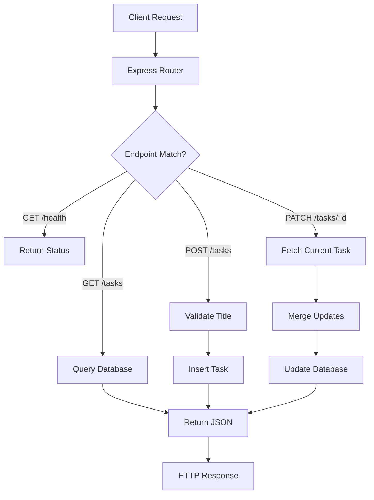

# API Endpoints

_Generated by Forge from `main` at `9e9f20c`._

# API Endpoints

The REST API is built with Express (Node.js) and provides endpoints for task management and health checks. It communicates with PostgreSQL via a connection pool and is deployed as a Cloud Run service on GCP. The API runs on port 3001 and is accessed through the frontend or directly via HTTP requests.

## Overview

The API implements a simple task manager with four core endpoints:

| Method | Path | Description |
|--------|------|-------------|
| GET | `/health` | Health check for monitoring |
| GET | `/tasks` | Retrieve all tasks |
| POST | `/tasks` | Create a new task |
| PATCH | `/tasks/:id` | Update a task (completion status or title) |

All endpoints return JSON responses. The API uses the `DATABASE_URL` environment variable to connect to PostgreSQL via `src/api/db.js`.

## Health Check

```
GET /health
```

Returns the API status for monitoring and load balancer health checks.

**Response (200 OK):**
```json
{ "status": "ok" }
```

## List Tasks

```
GET /tasks
```

Retrieves all tasks from the database, ordered by creation time.

**Response (200 OK):**
```json
[
  {
    "id": 1,
    "title": "Buy groceries",
    "completed": false,
    "created_at": "2025-01-15T10:30:00Z"
  },
  {
    "id": 2,
    "title": "Write documentation",
    "completed": true,
    "created_at": "2025-01-15T11:00:00Z"
  }
]
```

## Create Task

```
POST /tasks
```

Creates a new task with a required title. The title must be a non-empty string.

**Request body:**
```json
{ "title": "Learn Express" }
```

**Response (201 Created):**
```json
{
  "id": 3,
  "title": "Learn Express",
  "completed": false,
  "created_at": "2025-01-15T12:00:00Z"
}
```

**Error (400 Bad Request):**
```json
{ "error": "title is required" }
```

## Update Task

```
PATCH /tasks/:id
```

Updates a task's completion status and/or title. Both fields are optional; only provided fields are updated.

**Request body (update completion):**
```json
{ "completed": true }
```

**Request body (update title):**
```json
{ "title": "Updated task name" }
```

**Request body (update both):**
```json
{ "title": "New title", "completed": false }
```

**Response (200 OK):**
```json
{
  "id": 1,
  "title": "Updated task name",
  "completed": true,
  "created_at": "2025-01-15T10:30:00Z"
}
```

**Error (404 Not Found):**
```json
{ "error": "Not found" }
```

## Implementation Details

The API is implemented in `src/api/index.js` using Express 5 and Node.js 22. Key features:

- **JSON middleware**: All requests and responses use `express.json()`
- **Database connection**: Uses the `pg` library with a connection pool (`src/api/db.js`)
- **Input validation**: Title is required and trimmed on create and update
- **Error handling**: Returns appropriate HTTP status codes (201 for creation, 404 for missing resources, 400 for invalid input)

The API is containerized in `src/api/Dockerfile` and runs as a service in Docker Compose (internal port 3001) and on Cloud Run in production.

## Request Flow



## Testing

The API includes unit tests in `src/api/index.test.js` using Jest and Supertest. Run tests with:

```bash
npm test
```

## Sources
- `README.md`
- `src/api/index.js`
- `src/api/db.js`
- `src/api/package.json`
