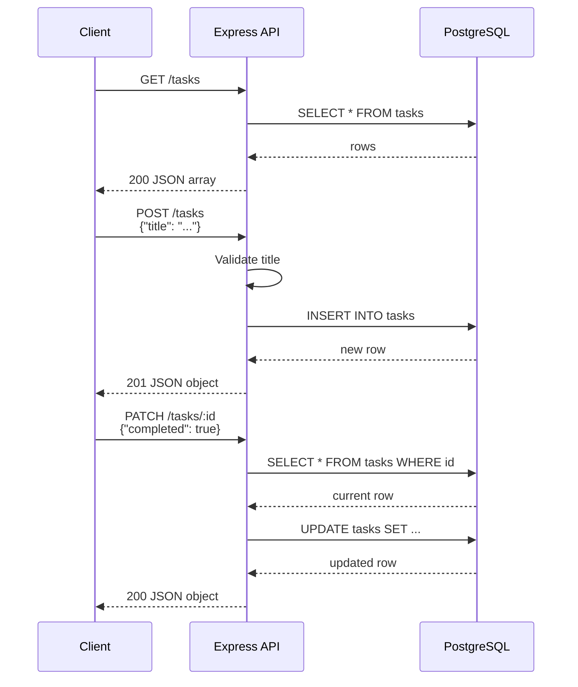

# API Endpoints

_Generated by Forge from `main` at `9e9f20c`._

This page documents all REST endpoints exposed by the Express API (`src/api/index.js`), including health checks, task CRUD operations, and their request/response formats. The API runs on port 3001 and communicates with the PostgreSQL database through a connection pool (`src/api/db.js`). All endpoints accept and return JSON.

## Health Check

| Method | Path | Description |
|--------|------|-------------|
| GET | `/health` | Returns API status |

**Response (200 OK):**
```json
{
  "status": "ok"
}
```

Use this endpoint to verify the API is running and healthy.

## Task Operations

### List All Tasks

| Method | Path | Description |
|--------|------|-------------|
| GET | `/tasks` | Retrieve all tasks, ordered by creation date |

**Response (200 OK):**
```json
[
  {
    "id": 1,
    "title": "Buy groceries",
    "completed": false,
    "created_at": "2025-01-15T10:30:00Z"
  },
  {
    "id": 2,
    "title": "Write documentation",
    "completed": true,
    "created_at": "2025-01-15T11:00:00Z"
  }
]
```

### Create a Task

| Method | Path | Description |
|--------|------|-------------|
| POST | `/tasks` | Create a new task |

**Request body:**
```json
{
  "title": "Learn Express"
}
```

**Response (201 Created):**
```json
{
  "id": 3,
  "title": "Learn Express",
  "completed": false,
  "created_at": "2025-01-15T12:00:00Z"
}
```

**Validation:**
- `title` is required and must be a non-empty string
- Whitespace is trimmed automatically
- Returns 400 Bad Request if validation fails

### Update a Task

| Method | Path | Description |
|--------|------|-------------|
| PATCH | `/tasks/:id` | Update task completion status or title |

**Request body (either or both fields):**
```json
{
  "completed": true,
  "title": "Updated task name"
}
```

**Response (200 OK):**
```json
{
  "id": 3,
  "title": "Updated task name",
  "completed": true,
  "created_at": "2025-01-15T12:00:00Z"
}
```

**Behavior:**
- Omitted fields retain their current values
- `completed` is coerced to boolean
- `title` is trimmed of whitespace
- Returns 404 Not Found if the task ID does not exist

## Error Responses

All errors return JSON with an `error` field:

```json
{
  "error": "Not found"
}
```

Common HTTP status codes:
- **400 Bad Request** — Invalid input (e.g., missing or invalid `title`)
- **404 Not Found** — Task ID does not exist
- **500 Internal Server Error** — Database or server error

## Request/Response Format

- **Content-Type:** `application/json`
- **Character encoding:** UTF-8
- All timestamps are ISO 8601 format (UTC)
- Task IDs are positive integers

## Database Connection

The API connects to PostgreSQL via the `DATABASE_URL` environment variable, which is read by the connection pool in `src/api/db.js`. The pool is shared across all requests for efficiency.

## Sequence Diagram



## Sources
- `README.md`
- `src/api/index.js`
- `src/api/db.js`
