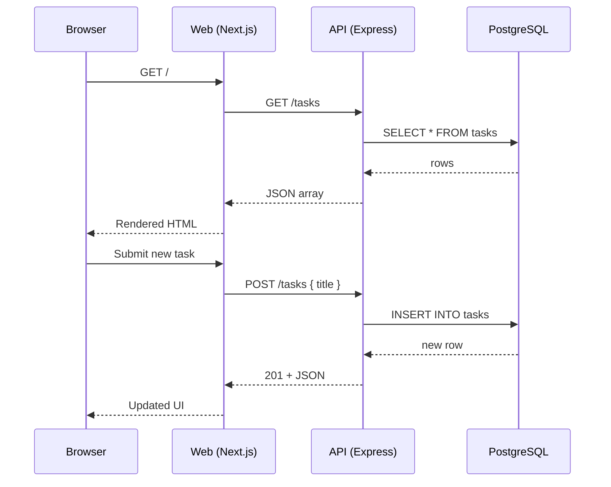

# API Endpoints

_Generated by Forge from `main` at `9e9f20c`._

This page documents the REST API endpoints for task management in the three-tier application. The Express API (`src/api/index.js`) provides four endpoints for health checks, listing tasks, creating new tasks, and updating existing tasks. All endpoints communicate with the PostgreSQL database through a connection pool defined in `src/api/db.js`.

## Endpoints

| Method | Path | Description |
|--------|------|-------------|
| GET | `/health` | Health check |
| GET | `/tasks` | List all tasks |
| POST | `/tasks` | Create a new task |
| PATCH | `/tasks/:id` | Update a task |

## Health Check

**GET `/health`**

Returns the API health status.

**Response:**
```json
{
  "status": "ok"
}
```

Use this endpoint to verify the API is running and responding to requests.

## List Tasks

**GET `/tasks`**

Retrieves all tasks from the database, ordered by creation time.

**Response:**
```json
[
  {
    "id": 1,
    "title": "Buy groceries",
    "completed": false,
    "created_at": "2025-01-15T10:30:00Z"
  },
  {
    "id": 2,
    "title": "Write documentation",
    "completed": true,
    "created_at": "2025-01-15T11:00:00Z"
  }
]
```

Returns an empty array if no tasks exist.

## Create Task

**POST `/tasks`**

Creates a new task with the provided title.

**Request body:**
```json
{
  "title": "Learn Express.js"
}
```

**Response (201 Created):**
```json
{
  "id": 3,
  "title": "Learn Express.js",
  "completed": false,
  "created_at": "2025-01-15T12:00:00Z"
}
```

**Validation:**
- `title` is required and must be a non-empty string
- Whitespace is trimmed before storage
- Returns `400 Bad Request` if validation fails

## Update Task

**PATCH `/tasks/:id`**

Updates an existing task. You can update the `completed` status, the `title`, or both.

**Request body (example 1 — mark as complete):**
```json
{
  "completed": true
}
```

**Request body (example 2 — rename):**
```json
{
  "title": "Updated task name"
}
```

**Response:**
```json
{
  "id": 3,
  "title": "Updated task name",
  "completed": true,
  "created_at": "2025-01-15T12:00:00Z"
}
```

**Error responses:**
- `404 Not Found` if the task ID does not exist
- Omitted fields retain their current values

## Implementation Details

The API is built with Express 5 and Node.js 22 (`src/api/index.js`). All endpoints:

- Accept and return JSON
- Use parameterized queries to prevent SQL injection
- Connect to PostgreSQL via a connection pool (`src/api/db.js`)
- Are not exposed directly when running locally; requests go through the Next.js frontend or require port mapping

The API listens on port 3001 (configurable via the `PORT` environment variable).

## Accessing the API

### Local development

When running with Docker Compose, the API is internal to the Docker network. Access it through:

- The Next.js frontend at `http://localhost:3000`
- Direct requests by temporarily mapping the port:
  ```bash
  docker compose up -p 3001:3001
  ```

### Production (GCP)

The API runs on Cloud Run and is accessed by the Cloud Run web frontend service. The API URL is not publicly exposed.

## Sequence Diagram



## Sources
- `README.md`
- `src/api/index.js`
