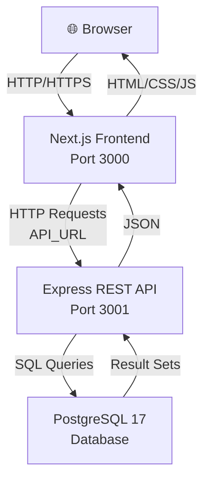

# Architecture

_Generated by Forge from `main` at `9e9f20c`._

# Architecture

This three-tier application separates concerns into a frontend layer (Next.js), an API layer (Express), and a database layer (PostgreSQL). Each tier runs in its own container and communicates through well-defined interfaces: the browser calls the frontend, the frontend calls the API, and the API queries the database. This design enables independent scaling, testing, and deployment of each component.

## System Overview



## Technology Stack

| Layer | Technology | Purpose | Location |
|-------|-----------|---------|----------|
| **Frontend** | Next.js 16, React 19, Tailwind CSS | Server-rendered UI, client-side interactivity | `src/web/` |
| **API** | Express 5, Node.js 22 | REST endpoints, business logic, data validation | `src/api/` |
| **Database** | PostgreSQL 17 | Persistent data storage | Managed by Docker / Cloud SQL |
| **Migrations** | node-pg-migrate | Schema versioning and evolution | `src/db/` |
| **Infrastructure** | Terraform | Infrastructure-as-code for GCP | `src/infrastructure/` |

## Frontend Layer (Next.js)

The frontend in `src/web/` is a Next.js application that serves the user interface. It:

- Renders pages and components using React 19
- Styles the UI with Tailwind CSS
- Makes HTTP requests to the API at the address specified by the `API_URL` environment variable
- Runs on port 3000 and is exposed to the host browser

In Docker Compose, the web service sets `API_URL=http://api:3001` to reach the API container by its service name.

## API Layer (Express)

The API in `src/api/` is an Express server that handles all business logic and data access. Key features:

- **Health check**: `GET /health` returns `{ status: 'ok' }`
- **Task operations**: CRUD endpoints for tasks (list, create, update)
- **Database connection**: Uses a connection pool in `src/api/db.js` to query PostgreSQL
- **JSON responses**: All endpoints return JSON
- **Port 3001**: Exposed internally to the web container; not directly accessible from the host in Docker Compose

Example from `src/api/index.js`:

```javascript
app.get('/tasks', async (_req, res) => {
  const { rows } = await db.query('SELECT * FROM tasks ORDER BY created_at ASC');
  res.json(rows);
});

app.post('/tasks', async (req, res) => {
  const { title } = req.body;
  const { rows } = await db.query(
    'INSERT INTO tasks (title) VALUES ($1) RETURNING *',
    [title.trim()]
  );
  res.status(201).json(rows[0]);
});
```

## Database Layer (PostgreSQL)

PostgreSQL 17 stores the application data. The database:

- Runs in a container managed by Docker Compose
- Uses a named volume `postgres_data` for persistence
- Credentials: user `app`, password `app`, database `app`
- Includes a health check to ensure readiness before migrations run
- Is accessed only by the API layer; the frontend never queries the database directly

## Communication Flow

### Local Development (Docker Compose)

The `docker-compose.yml` orchestrates four services in dependency order:

1. **postgres** — Starts first, waits until healthy
2. **migrate** — Runs `node-pg-migrate up` to apply schema migrations, then exits
3. **api** — Starts after migrations complete, listens on port 3001 (internal only)
4. **web** — Starts after the API is ready, listens on port 3000 (exposed to host)

The web container can reach the API at `http://api:3001` using Docker's internal DNS. The browser accesses the frontend at `http://localhost:3000`.

### Production (GCP)

On Google Cloud Platform, Terraform provisions:

- **Cloud SQL** — PostgreSQL instance with private IP
- **Cloud Run** — Two services: one for the API, one for the web frontend
- **VPC** — Private network so Cloud Run services can reach Cloud SQL
- **Secret Manager** — Stores the database connection URL
- **Service Accounts** — IAM roles for secure inter-service communication

The web Cloud Run service receives the API URL as an environment variable pointing to the API Cloud Run service's public URL.

## Data Flow Example: Creating a Task

1. User types a task title in the browser and clicks "Add"
2. Next.js frontend sends `POST /tasks` with `{ title: "..." }` to the API
3. Express validates the title and executes `INSERT INTO tasks (title) VALUES ($1) RETURNING *`
4. PostgreSQL inserts the row and returns the new task object
5. Express responds with `201 Created` and the task JSON
6. Next.js receives the response, updates the UI, and displays the new task

## Isolation and Security

- **Frontend isolation**: The frontend is a separate container; it cannot directly access the database
- **API as gateway**: All database access goes through the API, enabling centralized validation and authorization
- **Network boundaries**: In Docker Compose, the API is not exposed to the host; only the frontend is. In GCP, Cloud SQL has a private IP and is not accessible from the internet
- **Environment variables**: Sensitive data (database URL, API endpoint) is injected at runtime, not baked into images

## Sources
- `README.md`
- `docker-compose.yml`
- `src/api/index.js`
