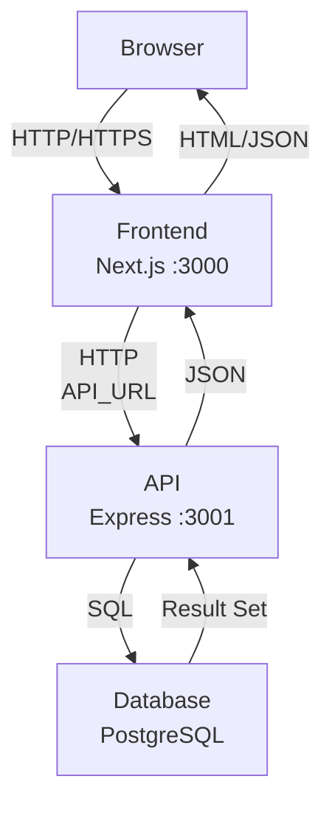

# Architecture

_Generated by Forge from `main` at `066e1ef`._

# Architecture

This three-tier application separates concerns into a frontend layer (Next.js), an API layer (Express), and a database layer (PostgreSQL). Each tier runs in its own container and communicates through well-defined interfaces. The browser makes requests to the frontend, which fetches data from the API, which queries the database. This architecture enables independent scaling, testing, and deployment of each layer.

## Layers Overview

| Layer | Technology | Port | Purpose |
|-------|-----------|------|---------|
| **Frontend** | Next.js 16, React 19, Tailwind CSS | 3000 | User interface and client-side logic |
| **API** | Express 5, Node.js 22 | 3001 | REST endpoints and business logic |
| **Database** | PostgreSQL 17 | 5432 | Persistent data storage |

The frontend and API are containerized in `src/web/` and `src/api/` respectively. Database migrations are managed by `src/db/` using node-pg-migrate. Infrastructure as code for GCP deployment lives in `src/infrastructure/`.

## Communication Flow

## Frontend Layer

The frontend (`src/web/`) is a Next.js application that serves the user interface. It runs on port 3000 and is exposed to the host machine. The frontend communicates with the API via HTTP requests to the URL specified by the `API_URL` environment variable (set to `http://api:3001` in Docker Compose).

Key responsibilities:
- Render pages and components using React
- Fetch data from the API endpoints
- Handle user interactions and form submissions
- Display task lists and manage UI state

## API Layer

The API (`src/api/index.js`) is an Express server that provides REST endpoints for the frontend to consume. It runs on port 3001 and is not directly exposed to the host; instead, it communicates with the frontend container over the Docker network.

The API exposes these endpoints:

| Method | Path | Description |
|--------|------|-------------|
| GET | `/health` | Health check (returns `{ status: 'ok' }`) |
| GET | `/tasks` | List all tasks, ordered by creation time |
| POST | `/tasks` | Create a new task (requires `{ "title": "..." }`) |
| PATCH | `/tasks/:id` | Update a task's completion status or title |

The API connects to PostgreSQL via a connection pool defined in `src/api/db.js`, using the `DATABASE_URL` environment variable.

## Database Layer

PostgreSQL 17 stores all application data. The database is initialized with migrations from `src/db/migrations/` using node-pg-migrate. In Docker Compose, the `migrate` service runs these migrations automatically after the database becomes healthy.

The application uses a simple schema with a `tasks` table containing:
- `id` (primary key)
- `title` (task description)
- `completed` (boolean flag)
- `created_at` (timestamp)

## Service Dependencies

The Docker Compose orchestration ensures services start in the correct order:

1. **postgres** — Starts first; other services wait for its health check to pass
2. **migrate** — Runs after postgres is healthy; applies schema migrations, then exits
3. **api** — Starts after migrations complete; connects to the database
4. **web** — Starts after the API is ready; connects to the API via `API_URL`

This dependency chain ensures the database is ready before the API attempts to connect, and the API is ready before the frontend tries to call it.

## Local Development

When running `docker compose up --build`, all four services start together. The frontend is accessible at `http://localhost:3000`. The API is not exposed directly but can be reached through the frontend or by temporarily mapping port 3001 on the host.

## Production Deployment

For GCP deployment, Terraform (`src/infrastructure/`) provisions:
- A VPC network with a private subnet for Cloud SQL
- A Cloud SQL PostgreSQL instance (private IP only)
- Cloud Run services for the API and frontend
- Secret Manager for the database connection string
- Service accounts and IAM roles for secure communication

The frontend Cloud Run service receives the API URL as an environment variable pointing to the API Cloud Run service's public URL.

---

## Sources
- `README.md`
- `docker-compose.yml`
- `src/api/index.js`
