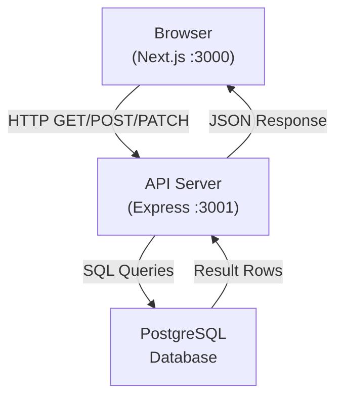

# Architecture

_Generated by Forge from `main` at `066e1ef`._

Perfect! I have all the information I need. Now I'll write the Architecture page.

---

# Architecture

This three-tier application separates concerns into a frontend layer (Next.js), an API layer (Express), and a database layer (PostgreSQL). Each tier runs in its own container and communicates through well-defined interfaces. The architecture is designed to be simple enough for learning yet realistic enough for production deployment to Google Cloud Platform.

## Application Layers

The application follows a classic three-tier architecture:

| Layer | Technology | Purpose |
|-------|-----------|---------|
| **Presentation** | Next.js 16, React 19, Tailwind CSS | Browser-based UI for task management |
| **Application** | Express 5, Node.js 22 | REST API handling business logic and data validation |
| **Data** | PostgreSQL 17 | Persistent storage with schema migrations |

Each layer is containerized independently and communicates over HTTP (frontend to API) and TCP (API to database).

## Data Flow



When a user interacts with the frontend:

1. **Browser** sends an HTTP request to the API (e.g., `GET /tasks`)
2. **API** (`src/api/index.js`) receives the request, validates input, and queries the database using a connection pool (`src/api/db.js`)
3. **Database** executes the SQL query and returns rows
4. **API** formats the response as JSON and sends it back to the browser
5. **Browser** updates the UI with the new data

## Frontend Layer

Located in `src/web/`, the Next.js application provides a React-based user interface. It communicates with the API via the `API_URL` environment variable (set to `http://api:3001` in Docker Compose). The frontend is stateless—all data is fetched from the API on demand.

## API Layer

The Express server in `src/api/` exposes four REST endpoints:

- `GET /health` — Health check for load balancers and orchestrators
- `GET /tasks` — Retrieve all tasks, ordered by creation time
- `POST /tasks` — Create a new task (requires `title` in request body)
- `PATCH /tasks/:id` — Update a task's `completed` status or `title`

The API uses a PostgreSQL connection pool (`src/api/db.js`) to manage database connections efficiently. All queries are parameterized to prevent SQL injection.

## Database Layer

PostgreSQL 17 stores the application state. The schema is managed via migrations in `src/db/migrations/` using [node-pg-migrate](https://salsita.github.io/node-pg-migrate/). The `migrate` service in Docker Compose runs all pending migrations before the API starts, ensuring the schema is always up-to-date.

## Container Orchestration

The `docker-compose.yml` file defines four services with explicit startup ordering:

```yaml
postgres → migrate → api → web
```

- **postgres** waits until healthy before other services start
- **migrate** runs schema migrations and exits; the API waits for this to complete
- **api** starts only after migrations succeed
- **web** starts last and can reach the API via the internal Docker network

This ordering prevents race conditions and ensures the database is ready before any application code runs.

## Deployment Architecture

For production on Google Cloud Platform, Terraform in `src/infrastructure/` provisions:

- **Cloud SQL** for PostgreSQL (private IP, no public access)
- **Cloud Run** services for the API and web frontend (auto-scaling, managed)
- **VPC** network to keep the database private
- **Secret Manager** for the database connection URL
- **Service accounts** and IAM bindings for secure inter-service communication

The deployment uses the same Docker images built locally, ensuring consistency between development and production.

## Technology Stack Summary

| Component | Technology | Version |
|-----------|-----------|---------|
| Frontend framework | Next.js | 16 |
| UI library | React | 19 |
| Styling | Tailwind CSS | Latest |
| API framework | Express | 5 |
| Runtime | Node.js | 22 |
| Database | PostgreSQL | 17 |
| Migration tool | node-pg-migrate | Latest |
| Infrastructure | Terraform | Latest |
| Containerization | Docker | Latest |

---

## Sources
- `README.md`
- `docker-compose.yml`
- `src/api/index.js`
- `src/api/db.js`
