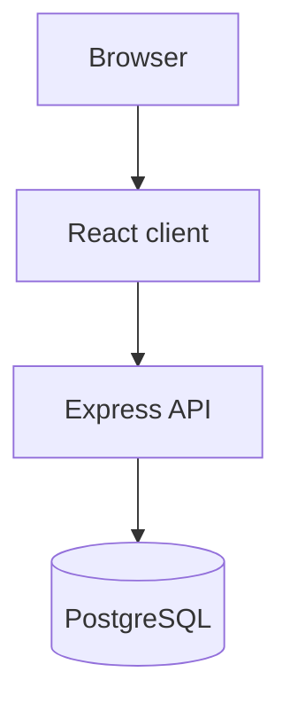

# Architecture

_Generated by Forge from `main` at `76d22b1`._

Requests flow from the browser to the API, which queries Postgres.

## Components
- **Client** calls `/api/*`.
- **Server** in `server/index.js` uses a `pg` pool.

## Sources
- `server/index.js`
