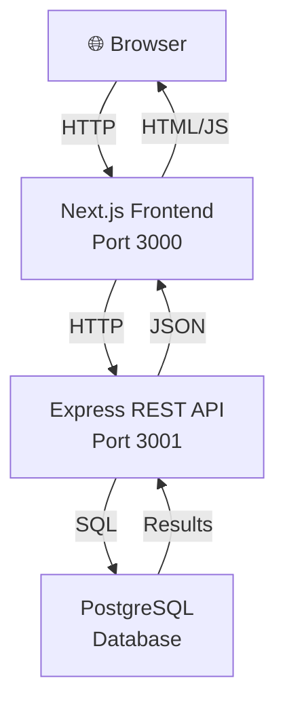

# Architecture

_Generated by Forge from `main` at `9e9f20c`._

# Architecture

This three-tier application separates concerns into a web frontend, REST API, and database layer, each running in its own container and communicating over HTTP and SQL protocols. The architecture enables independent scaling, testing, and deployment of each tier while maintaining a clean separation of responsibilities.

## System Overview

## Technology Stack

| Layer | Technology | Port | Purpose |
|-------|-----------|------|---------|
| **Frontend** | Next.js 16, React 19, Tailwind CSS | 3000 | User interface and client-side logic |
| **API** | Express 5, Node.js 22 | 3001 | REST endpoints and business logic |
| **Database** | PostgreSQL 17 | 5432 | Persistent data storage |
| **Migrations** | node-pg-migrate | — | Schema version control |

## Layer Responsibilities

### Frontend (`src/web/`)

The Next.js frontend provides the user interface for the task manager application. It runs on port 3000 and communicates exclusively with the API layer via HTTP requests. The frontend is exposed to the browser and handles:

- Rendering React components with Tailwind CSS styling
- Fetching tasks from the API
- Submitting task creation and updates
- Client-side state management and UI interactions

The frontend discovers the API via the `API_URL` environment variable, which points to `http://api:3001` in Docker Compose and to the Cloud Run API service URL in production.

### API (`src/api/`)

The Express REST API runs on port 3001 and serves as the single source of truth for business logic. It exposes four endpoints (defined in `src/api/index.js`):

- `GET /health` — Health check for orchestration
- `GET /tasks` — Retrieve all tasks
- `POST /tasks` — Create a new task (requires `title` in JSON body)
- `PATCH /tasks/:id` — Update a task's `completed` status or `title`

The API connects to PostgreSQL using a connection pool (`src/api/db.js`) and is not directly exposed to the browser; all requests flow through the frontend.

### Database (`src/db/`)

PostgreSQL 17 stores the application state in a `tasks` table. The schema is managed through migrations in `src/db/migrations/`, applied automatically by the `migrate` service on startup. The database is only accessible from the API and migration containers, ensuring data integrity and security.

## Communication Flow

1. **User Action** → Browser sends HTTP request to Next.js frontend (port 3000)
2. **Frontend Processing** → Next.js renders the page and makes API calls to `http://api:3001`
3. **API Logic** → Express validates input, executes business logic, and queries PostgreSQL
4. **Database Query** → PostgreSQL executes SQL and returns results
5. **Response Chain** → API returns JSON to frontend, frontend renders updated UI to browser

## Docker Compose Orchestration

The `docker-compose.yml` defines four services with explicit startup ordering:

1. **postgres** — Starts first, waits until healthy (pg_isready check)
2. **migrate** — Runs after postgres is healthy, applies schema migrations, then exits
3. **api** — Starts after migrations complete, listens on port 3001 (internal only)
4. **web** — Starts after API is ready, listens on port 3000 (exposed to host)

This dependency chain ensures the database schema exists before the API attempts to query it, and the API is ready before the frontend tries to connect.

## Environment Configuration

Each service receives configuration via environment variables:

- **postgres**: `POSTGRES_DB`, `POSTGRES_USER`, `POSTGRES_PASSWORD`
- **migrate**: `DATABASE_URL` (connection string to postgres)
- **api**: `PORT`, `DATABASE_URL`
- **web**: `PORT`, `API_URL` (internal Docker hostname or production Cloud Run URL)

## Deployment Architecture

In production on Google Cloud Platform, the three-tier architecture maps to:

- **Frontend** → Cloud Run service (Next.js container)
- **API** → Cloud Run service (Express container)
- **Database** → Cloud SQL PostgreSQL instance (private IP, VPC-connected)

Terraform in `src/infrastructure/` provisions the GCP resources, including VPC networking, service accounts, and IAM bindings to ensure secure communication between tiers.

## Sources
- `README.md`
- `docker-compose.yml`
- `src/api/index.js`
