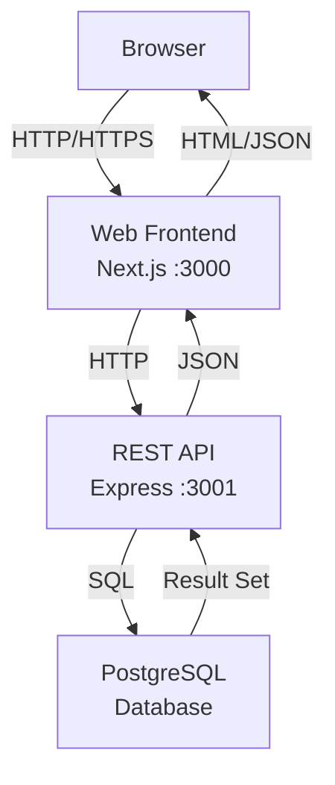

# Architecture

_Generated by Forge from `main` at `9e9f20c`._

This application follows a classic three-tier architecture pattern: a Next.js frontend on port 3000 communicates with an Express REST API on port 3001, which in turn queries a PostgreSQL database. Each tier runs in its own Docker container, orchestrated by Docker Compose for local development, and can be deployed independently to Google Cloud Platform using Terraform.

## Layers

| Layer | Technology | Port | Location |
|-------|-----------|------|----------|
| **Frontend** | Next.js 16, React 19, Tailwind CSS | 3000 | `src/web/` |
| **API** | Express 5, Node.js 22 | 3001 | `src/api/` |
| **Database** | PostgreSQL 17 | 5432 | managed by Docker / Cloud SQL |
| **Migrations** | node-pg-migrate | — | `src/db/` |

## Data Flow

## Frontend Layer

The Next.js frontend (`src/web/`) provides the user interface for the task manager application. It runs on port 3000 and is exposed to the host machine. The frontend communicates with the API via HTTP requests to the internal service URL `http://api:3001` (within Docker Compose).

## API Layer

The Express API (`src/api/`) exposes REST endpoints for task management. It runs on port 3001 and is not directly exposed to the host during local development—requests flow through the frontend. The API connects to PostgreSQL using a connection pool and handles all business logic and data validation.

**Key endpoints:**
- `GET /health` — Health check
- `GET /tasks` — List all tasks
- `POST /tasks` — Create a task
- `PATCH /tasks/:id` — Update a task

## Database Layer

PostgreSQL 17 stores the application data. The database is initialized with a schema defined in migration files (`src/db/migrations/`), which are applied automatically by the `migrate` service on startup. The database runs on port 5432 and persists data in a Docker volume (`postgres_data`).

## Service Orchestration

The `docker-compose.yml` file defines four services with explicit startup order:

1. **postgres** — Starts first; waits until healthy before proceeding
2. **migrate** — Runs after postgres is healthy; applies pending migrations, then exits
3. **api** — Starts after migrations complete; exposes port 3001 internally
4. **web** — Starts after api is ready; exposes port 3000 to the host

Each service has environment variables for configuration (e.g., `DATABASE_URL`, `API_URL`, `PORT`). The `depends_on` constraints ensure services start in the correct order and are ready before dependents begin.

## Infrastructure as Code

The `src/infrastructure/` directory contains Terraform modules that provision the same architecture on Google Cloud Platform:

- **VPC & Networking** — Private VPC with subnet for secure communication
- **Cloud SQL** — Managed PostgreSQL 17 instance on private IP
- **Cloud Run** — Serverless containers for the API and web frontend
- **Secret Manager** — Stores the database connection URL
- **IAM** — Service accounts and role bindings for least-privilege access

This allows the local Docker Compose setup to mirror production infrastructure on GCP.

## Sources
- `README.md`
- `docker-compose.yml`
