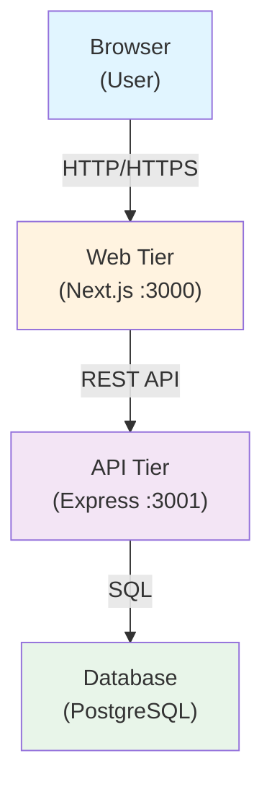

# Architecture

_Generated by Forge from `main` at `76d22b1`._

Perfect! Now I have enough information to write the Architecture page. Let me create it:

---

# Architecture

This three-tier application separates concerns across a browser-based frontend, a REST API backend, and a managed database. Each tier runs independently and communicates via well-defined interfaces, making the system scalable, testable, and easy to deploy to cloud platforms like Google Cloud Platform.

## System Overview

## Tier Breakdown

| Layer | Technology | Port | Location | Purpose |
|-------|-----------|------|----------|---------|
| **Frontend** | Next.js 16, React 19, Tailwind CSS | 3000 | `src/web/` | User interface; server-side rendering and static generation |
| **API** | Express 5, Node.js 22 | 3001 | `src/api/` | REST endpoints; business logic; database queries |
| **Database** | PostgreSQL 17 | 5432 | Docker / Cloud SQL | Persistent data storage; schema managed by migrations |

## Frontend Tier

The frontend in `src/web/` is a Next.js application that serves the user interface. It:

- Renders React components with Tailwind CSS styling
- Makes HTTP requests to the API tier at `http://api:3001` (in Docker) or the deployed API URL (in production)
- Uses Next.js App Router for page organization
- Handles client-side state and form submission

The frontend is exposed on port 3000 and is the only service accessible to end users.

## API Tier

The API in `src/api/` is an Express server that provides REST endpoints for task management. Key responsibilities:

- **Health check**: `GET /health` — returns `{ status: 'ok' }`
- **List tasks**: `GET /tasks` — returns all tasks ordered by creation time
- **Create task**: `POST /tasks` — accepts `{ title: "..." }` and returns the created task
- **Update task**: `PATCH /tasks/:id` — accepts `{ completed: true/false }` or `{ title: "..." }` to modify a task

The API connects to PostgreSQL via a connection pool defined in `src/api/db.js` and uses parameterized queries to prevent SQL injection. The API is not directly exposed to users; it communicates only with the frontend tier and the database.

## Database Tier

PostgreSQL 17 stores the application data. The schema is version-controlled and applied via migrations in `src/db/migrations/` using [node-pg-migrate](https://salsita.github.io/node-pg-migrate/).

- **Local development**: PostgreSQL runs in a Docker container with a persistent volume (`postgres_data`)
- **Production (GCP)**: PostgreSQL runs on Cloud SQL with automatic backups and high availability
- **Migrations**: Applied automatically by the `migrate` service in Docker Compose before the API starts

## Communication Flow

1. **Browser → Web**: User opens the frontend in a browser; Next.js serves HTML, CSS, and JavaScript
2. **Web → API**: Frontend makes fetch requests to `/tasks`, `/tasks/:id`, etc.
3. **API → Database**: Express queries PostgreSQL for task data
4. **Database → API**: PostgreSQL returns rows; Express formats and sends JSON to the frontend
5. **API → Web**: Frontend receives JSON and updates the UI

## Docker Compose Orchestration

The `docker-compose.yml` file defines the local development stack with service dependencies:

1. **postgres** — starts first; waits until healthy
2. **migrate** — runs after postgres is healthy; applies pending migrations, then exits
3. **api** — starts after migrations complete; listens on port 3001 (internal only)
4. **web** — starts after api is ready; listens on port 3000 (exposed to host)

This ensures the database schema is ready before the API attempts to query it, and the API is ready before the frontend tries to connect.

## Deployment Architecture (GCP)

In production, the three tiers deploy to Google Cloud Platform via Terraform (`src/infrastructure/`):

- **Frontend**: Cloud Run service (stateless, auto-scaling)
- **API**: Cloud Run service (stateless, auto-scaling)
- **Database**: Cloud SQL PostgreSQL instance (managed, private IP)
- **Networking**: VPC with private subnet; Cloud Run services communicate via internal VPC connector
- **Secrets**: Database URL stored in Secret Manager; injected at runtime

This architecture provides automatic scaling, managed backups, and zero-downtime deployments.

## Sources
- `README.md`
- `docker-compose.yml`
- `src/api/index.js`
