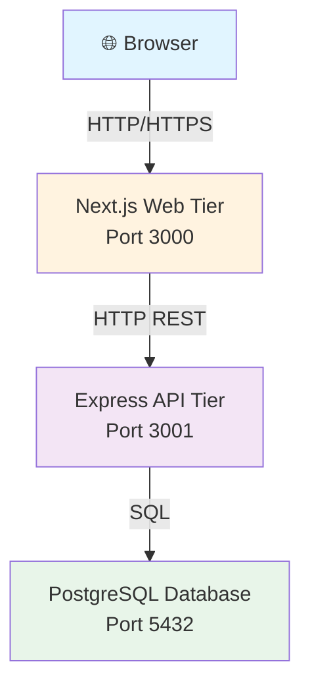

# Architecture

_Generated by Forge from `main` at `9e9f20c`._

# Architecture

This application follows a classic three-tier architecture pattern: a browser-based frontend communicates with a REST API backend, which in turn queries a relational database. Each tier is independently deployable and runs in its own container, allowing for scalability and separation of concerns.

## System Overview

## Tier Breakdown

### Presentation Tier (Frontend)

The frontend is built with **Next.js 16** and **React 19**, providing a modern, interactive user interface. It runs on port 3000 and is the only service exposed to end users. The frontend communicates exclusively with the API tier via HTTP REST calls, never directly accessing the database.

- **Location:** `src/web/`
- **Technology:** Next.js, React, Tailwind CSS
- **Port:** 3000 (exposed)
- **Responsibilities:** Render UI, handle user interactions, call API endpoints

### Application Tier (API)

The API tier is an **Express 5** server running on **Node.js 22**. It exposes a REST interface for CRUD operations on tasks and handles all business logic, validation, and database queries. The API is not directly exposed to the internet in the local Docker setup; it communicates with the web tier over an internal network.

- **Location:** `src/api/`
- **Technology:** Express 5, Node.js 22
- **Port:** 3001 (internal only)
- **Responsibilities:** Route handling, request validation, database queries, response formatting

**Key endpoints:**

| Method | Path | Description |
|--------|------|-------------|
| GET | `/health` | Health check |
| GET | `/tasks` | List all tasks |
| POST | `/tasks` | Create a task |
| PATCH | `/tasks/:id` | Update a task |

The API uses a PostgreSQL connection pool (`src/api/db.js`) to manage database connections efficiently.

### Data Tier (Database)

**PostgreSQL 17** serves as the persistent data store. It runs in a dedicated container and is not exposed to the host or internet. All data access flows through the API tier via parameterized queries to prevent SQL injection.

- **Technology:** PostgreSQL 17
- **Port:** 5432 (internal only)
- **Responsibilities:** Data persistence, ACID compliance, query execution

Database schema is managed via **node-pg-migrate** migrations stored in `src/db/migrations/`.

## Communication Flow

1. **Browser → Web:** User opens the application in a browser and makes requests to `http://localhost:3000`. The Next.js server renders pages and serves static assets.

2. **Web → API:** When the user interacts with the UI (e.g., creating a task), the frontend makes HTTP REST calls to the API at `http://api:3001` (using the internal Docker network name).

3. **API → Database:** The API receives the request, validates input, constructs a SQL query, and executes it against PostgreSQL using the connection pool.

4. **Response chain:** The database returns results, the API formats them as JSON, the frontend receives and renders the data, and the user sees the updated UI.

## Deployment Architecture

The same three-tier design scales to **Google Cloud Platform** via Terraform (`src/infrastructure/`):

- **Frontend:** Cloud Run service (Next.js container)
- **API:** Cloud Run service (Express container)
- **Database:** Cloud SQL PostgreSQL instance (managed service)
- **Networking:** VPC with private subnet for Cloud SQL; Cloud Run services communicate over internal networking
- **Secrets:** Database URL stored in Secret Manager

## Local Development with Docker Compose

The `docker-compose.yml` orchestrates four services in dependency order:

1. **postgres** — PostgreSQL database with health checks
2. **migrate** — Runs migrations, then exits
3. **api** — Express server (depends on migrate)
4. **web** — Next.js server (depends on api)

Services communicate via Docker's internal network using service names as hostnames (e.g., `http://api:3001`).

## Key Design Principles

- **Separation of Concerns:** Each tier has a single responsibility and can be developed, tested, and deployed independently.
- **Statelessness:** The API and web tiers are stateless; all state is in the database or the browser.
- **Security:** The database is never exposed directly; all access flows through the API with parameterized queries.
- **Scalability:** Each tier can be scaled independently (e.g., run multiple API replicas behind a load balancer).
- **Portability:** The same Docker images run locally and on GCP without modification.

---

## Sources
- `README.md`
- `docker-compose.yml`
- `src/api/index.js`
- `src/api/db.js`
