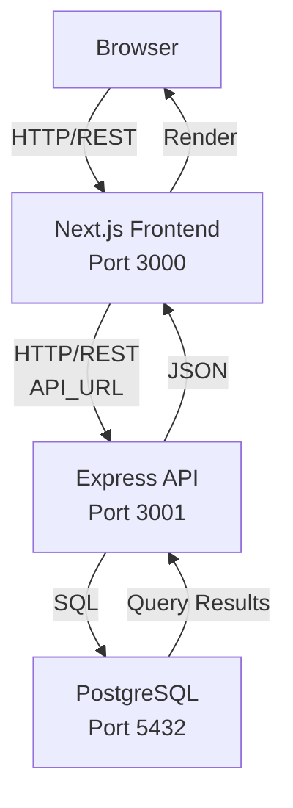

# Architecture

_Generated by Forge from `main` at `9e9f20c`._

This application implements a classic three-tier architecture: a Next.js web frontend communicates with an Express REST API, which in turn queries a PostgreSQL database. The tiers are containerized with Docker and orchestrated locally via Docker Compose, while infrastructure-as-code (Terraform) enables deployment to Google Cloud Platform. The design separates concerns cleanly—presentation logic in the frontend, business logic in the API, and data persistence in the database—making the system scalable and maintainable.

## Layers

| Layer | Technology | Purpose | Location |
|-------|-----------|---------|----------|
| **Frontend** | Next.js 16, React 19, Tailwind CSS | User interface and client-side logic | `src/web/` |
| **API** | Express 5, Node.js 22 | REST endpoints and business logic | `src/api/` |
| **Database** | PostgreSQL 17 | Data persistence and schema | managed by Docker / Cloud SQL |
| **Migrations** | node-pg-migrate | Schema versioning and evolution | `src/db/` |

## Data Flow

## Frontend Layer

The Next.js frontend (`src/web/`) provides the user interface for a task manager application. It uses React 19 components and Tailwind CSS for styling. The frontend communicates with the API via HTTP requests to the endpoint specified by the `API_URL` environment variable (set to `http://api:3001` in Docker Compose).

Key responsibilities:
- Render task lists and forms
- Handle user interactions (create, update, complete tasks)
- Make HTTP calls to the API
- Display real-time updates

## API Layer

The Express API (`src/api/index.js`) exposes REST endpoints that the frontend consumes. It connects to PostgreSQL via a connection pool and handles all business logic.

Core endpoints:
- `GET /health` — Health check
- `GET /tasks` — Retrieve all tasks
- `POST /tasks` — Create a new task
- `PATCH /tasks/:id` — Update a task (mark complete or rename)

The API validates input, queries the database, and returns JSON responses. It runs on port 3001 and is not directly exposed to the host in Docker Compose; the frontend accesses it via the internal Docker network.

## Database Layer

PostgreSQL 17 stores the application data. The database is initialized with a schema defined in migration files (`src/db/migrations/`). The `migrate` service in Docker Compose runs `node-pg-migrate up` on startup to apply all pending migrations before the API starts.

The database connection is managed via a connection pool in `src/api/db.js`, which uses the `DATABASE_URL` environment variable to connect.

## Docker Compose Orchestration

The `docker-compose.yml` file defines four services that start in dependency order:

1. **postgres** — PostgreSQL 17 database with a health check
2. **migrate** — Runs migrations and exits (depends on postgres being healthy)
3. **api** — Express server (depends on migrate completing successfully)
4. **web** — Next.js frontend (depends on api being ready)

Each service is built from its own Dockerfile and communicates via the Docker internal network. Only the `web` service exposes a port (3000) to the host.

## Infrastructure as Code

The `src/infrastructure/` directory contains Terraform modules that provision the same architecture on Google Cloud Platform:

- **VPC and networking** — Private subnet for Cloud SQL
- **Cloud SQL** — Managed PostgreSQL 17 instance
- **Cloud Run** — Serverless containers for the API and web frontend
- **Secret Manager** — Stores the database connection URL
- **IAM** — Service accounts and role bindings for secure inter-service communication

This allows the same application to run identically in development (Docker Compose) and production (GCP).

## Sources
- `README.md`
- `docker-compose.yml`
- `src/api/index.js`
