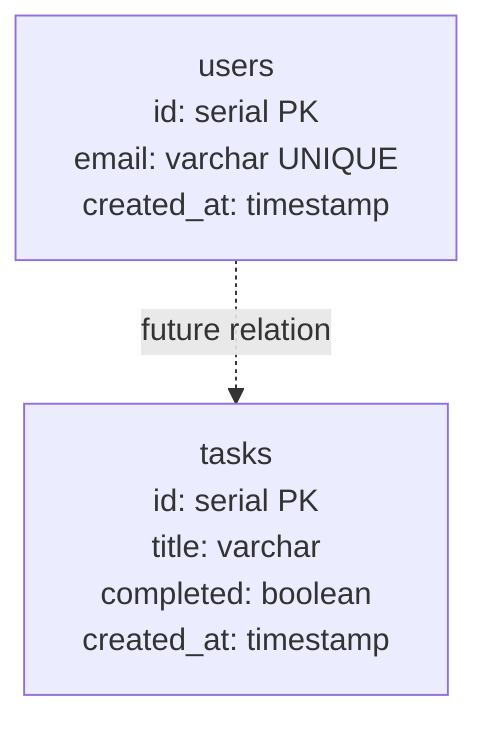

# Database Schema

_Generated by Forge from `main` at `066e1ef`._

The three-tier application uses PostgreSQL as its relational database, with schema managed through **node-pg-migrate** for version control and reproducible deployments. The database currently contains two tables: `users` and `tasks`, created through sequential migrations that can be applied or rolled back independently.

## Migration System

The project uses `node-pg-migrate` (v8.0.4) to manage database schema changes. Migrations are stored in `src/db/migrations/` as numbered JavaScript files that export `up` and `down` functions. This approach ensures:

- **Version control**: Each migration is timestamped and tracked in git
- **Rollback capability**: The `down` function allows reverting changes
- **Reproducibility**: New environments can apply all migrations in order

Run migrations with npm scripts in `src/db/package.json`:

```bash
npm run migrate      # Apply pending migrations
npm run migrate:down # Rollback the last migration
```

## Tables

### users

Created in `src/db/migrations/1718500000000_initial-schema.js`, the `users` table stores application users.

| Column | Type | Constraints | Notes |
|--------|------|-------------|-------|
| `id` | `serial` | PRIMARY KEY | Auto-incrementing identifier |
| `email` | `varchar(255)` | NOT NULL, UNIQUE | User email address |
| `created_at` | `timestamp` | NOT NULL, DEFAULT now() | Account creation timestamp |

### tasks

Created in `src/db/migrations/1718500001000_create-tasks.js`, the `tasks` table stores task items.

| Column | Type | Constraints | Notes |
|--------|------|-------------|-------|
| `id` | `serial` | PRIMARY KEY | Auto-incrementing identifier |
| `title` | `varchar(500)` | NOT NULL | Task description |
| `completed` | `boolean` | NOT NULL, DEFAULT false | Completion status |
| `created_at` | `timestamp` | NOT NULL, DEFAULT now() | Task creation timestamp |

## Schema Diagram



## Migration Execution

Migrations are executed sequentially by timestamp. The database tracks applied migrations internally, preventing duplicate execution. Each migration is atomic—either fully applied or fully rolled back.

The `up` function uses the `pgm` object (provided by node-pg-migrate) to define schema changes:
- `pgm.createTable()` — Define a new table with columns and constraints
- `pgm.dropTable()` — Remove a table

The `down` function reverses the changes, enabling safe rollback during development or if a migration needs correction.

## Sources
- `src/db/migrations/1718500000000_initial-schema.js`
- `src/db/migrations/1718500001000_create-tasks.js`
- `src/db/package.json`
