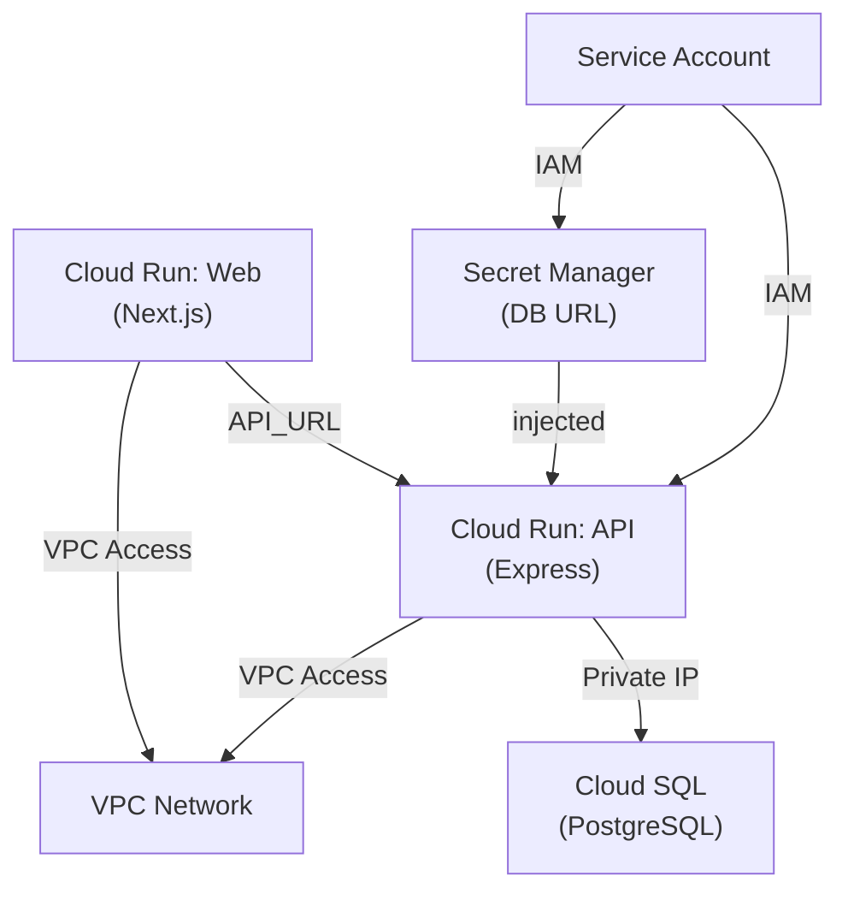

# Deployment to GCP

_Generated by Forge from `main` at `76d22b1`._

Perfect! Now I have all the information I need to write the "Deployment to GCP" page. Let me create it:

---

# Deployment to GCP

This application deploys to Google Cloud Platform using Terraform, which provisions a complete infrastructure stack: a VPC network, Cloud SQL PostgreSQL database, and Cloud Run services for both the API and web frontend. The deployment is fully automated and supports multiple environments (dev, staging, prod) with environment-specific configurations.

## Infrastructure Overview

The Terraform configuration in `src/infrastructure/` creates the following GCP resources:



| Component | Purpose |
|-----------|---------|
| **VPC Network** | Private network isolating Cloud SQL from the internet |
| **VPC Access Connector** | Allows Cloud Run services to reach the private VPC |
| **Cloud SQL** | PostgreSQL 17 database with private IP, automatic backups in prod |
| **Cloud Run (API)** | Internal-only service running the Express API |
| **Cloud Run (Web)** | Public-facing service running the Next.js frontend |
| **Secret Manager** | Stores the database connection URL securely |
| **Service Account** | Grants Cloud Run permission to access Cloud SQL and secrets |

## Prerequisites

- GCP project with billing enabled
- [Terraform](https://www.terraform.io/downloads) ≥ 1.5
- [Google Cloud CLI](https://cloud.google.com/sdk/docs/install) (`gcloud`)
- Container images pushed to Google Container Registry (GCR)

### Authenticate with GCP

```bash
gcloud auth login
gcloud config set project MY_PROJECT_ID
```

### Build and push container images

Before deploying, build and push the API, web, and database images to GCR:

```bash
PROJECT_ID=$(gcloud config get-value project)

docker build -t gcr.io/$PROJECT_ID/api:latest ./src/api
docker build -t gcr.io/$PROJECT_ID/web:latest ./src/web
docker build -t gcr.io/$PROJECT_ID/db:latest ./src/db

docker push gcr.io/$PROJECT_ID/api:latest
docker push gcr.io/$PROJECT_ID/web:latest
docker push gcr.io/$PROJECT_ID/db:latest
```

## Configuration

Create a `terraform.tfvars` file in `src/infrastructure/` based on `terraform.tfvars.example`:

```hcl
project_id  = "my-gcp-project-id"
region      = "us-central1"
app_name    = "todo"
environment = "dev"
db_tier     = "db-f1-micro"
api_image   = "gcr.io/my-gcp-project-id/api:latest"
web_image   = "gcr.io/my-gcp-project-id/web:latest"
```

### Key variables

| Variable | Type | Default | Notes |
|----------|------|---------|-------|
| `project_id` | string | — | **Required.** Your GCP project ID |
| `region` | string | `us-central1` | GCP region for all resources |
| `environment` | string | `dev` | One of: `dev`, `staging`, `prod` |
| `db_tier` | string | `db-f1-micro` | Cloud SQL machine type; use `db-g1-small` or higher for prod |
| `api_image` | string | — | **Required.** GCR image URI for the API |
| `web_image` | string | — | **Required.** GCR image URI for the web frontend |
| `api_max_instances` | number | `10` | Max Cloud Run instances for API |
| `web_max_instances` | number | `10` | Max Cloud Run instances for web |

Environment-specific behavior:

- **dev/staging**: Cloud SQL is zonal, backups disabled, min instances = 0 (scales to zero)
- **prod**: Cloud SQL is regional with HA, backups enabled, min instances = 1, deletion protection enabled

## Deployment Steps

### 1. Initialize Terraform

```bash
cd src/infrastructure
terraform init -backend-config="bucket=MY_BUCKET" -backend-config="prefix=terraform/state"
```

This configures the remote state backend in Google Cloud Storage. Create the bucket first if needed:

```bash
gsutil mb gs://MY_BUCKET
```

### 2. Plan the deployment

```bash
terraform plan -out=tfplan
```

Review the output to verify all resources will be created correctly.

### 3. Apply the configuration

```bash
terraform apply tfplan
```

Terraform will provision all resources. This typically takes 5–10 minutes.

### 4. Retrieve the web URL

```bash
terraform output web_url
```

This outputs the public URL of the Next.js frontend. Open it in your browser.

## Database Migrations

After deployment, the database schema is empty. Run migrations using the `db` image:

```bash
gcloud run jobs create migrate-db \
  --image=gcr.io/$PROJECT_ID/db:latest \
  --region=us-central1 \
  --set-env-vars="DATABASE_URL=$(terraform output -raw db_url)" \
  --vpc-connector=todo-dev-connector

gcloud run jobs execute migrate-db --region=us-central1
```

Alternatively, use the migration job defined in `src/infrastructure/migration.tf`, which runs automatically on each `terraform apply`.

## Monitoring and Logs

View Cloud Run logs:

```bash
gcloud run services logs read todo-dev-api --region=us-central1 --limit=50
gcloud run services logs read todo-dev-web --region=us-central1 --limit=50
```

View Cloud SQL logs:

```bash
gcloud sql operations list --instance=todo-dev-postgres
```

## Scaling and Performance

- **Cloud Run**: Automatically scales based on traffic. Set `min_instance_count` to 0 for dev to save costs; use 1+ for prod.
- **Cloud SQL**: Disk auto-resizes. For production, upgrade `db_tier` to `db-g1-small` or `db-custom-*` and enable backups.
- **VPC Access Connector**: Configured with 2–10 instances; adjust `min_instances` and `max_instances` if needed.

## Cleanup

To destroy all GCP resources:

```bash
terraform destroy
```

This removes the VPC, Cloud SQL instance, Cloud Run services, and all other provisioned resources. **Warning**: This is irreversible for prod environments with deletion protection.

## Troubleshooting

| Issue | Solution |
|-------|----------|
| `Error: Service account not found` | Ensure the service account was created; check IAM bindings. |
| `Error: VPC Access Connector not ready` | Wait 2–3 minutes; connectors take time to provision. |
| `Cloud Run service fails to start` | Check logs: `gcloud run services logs read SERVICE_NAME`. Verify `DATABASE_URL` secret exists. |
| `Database connection timeout` | Verify Cloud SQL instance is in the same VPC and private IP is reachable. |
| `Terraform state lock` | If stuck, check for concurrent applies; release the lock in Cloud Storage. |

## Sources
- `README.md`
- `src/infrastructure/main.tf`
- `src/infrastructure/variables.tf`
- `src/infrastructure/terraform.tfvars.example`
