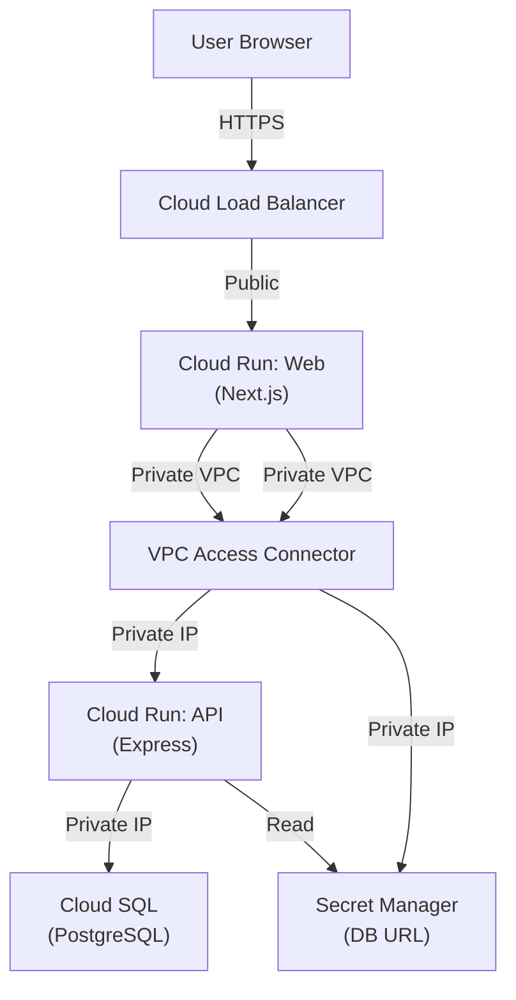

# Deployment to GCP

_Generated by Forge from `main` at `9e9f20c`._

This page describes how to deploy the three-tier application to Google Cloud Platform using Terraform. The infrastructure code provisions a VPC network, Cloud SQL PostgreSQL database, two Cloud Run services (API and web frontend), and the necessary networking and security components to connect them securely.

## Prerequisites

Before deploying, ensure you have:

- A GCP project with billing enabled
- [Terraform](https://www.terraform.io/downloads) ≥ 1.5 installed
- [Google Cloud CLI](https://cloud.google.com/sdk/docs/install) (`gcloud`) configured with your project
- Container images built and pushed to Google Container Registry (GCR) or Artifact Registry
- A GCS bucket for Terraform state (recommended for production)

## Building and pushing container images

Before running Terraform, build and push the API and web container images to your GCP project's container registry:

```bash
# Set your GCP project ID
export PROJECT_ID="my-gcp-project-id"

# Build and push the API image
docker build -t gcr.io/$PROJECT_ID/api:latest ./src/api
docker push gcr.io/$PROJECT_ID/api:latest

# Build and push the web image
docker build -t gcr.io/$PROJECT_ID/web:latest ./src/web
docker push gcr.io/$PROJECT_ID/web:latest
```

## Configuration

The Terraform configuration is in `src/infrastructure/`. Start by copying the example variables file:

```bash
cd src/infrastructure
cp terraform.tfvars.example terraform.tfvars
```

Edit `terraform.tfvars` with your values:

| Variable | Required | Description |
|----------|----------|-------------|
| `project_id` | Yes | Your GCP project ID |
| `api_image` | Yes | Full image URI for the API (e.g., `gcr.io/my-project/api:latest`) |
| `web_image` | Yes | Full image URI for the web frontend |
| `region` | No | GCP region (default: `us-central1`) |
| `environment` | No | `dev`, `staging`, or `prod` (default: `dev`) |
| `db_tier` | No | Cloud SQL machine tier (default: `db-f1-micro`) |
| `app_name` | No | Application name prefix (default: `todo`) |
| `subnet_cidr` | No | VPC subnet CIDR (default: `10.0.0.0/24`) |
| `connector_cidr` | No | VPC Access Connector CIDR (default: `10.0.1.0/28`) |

For production deployments, use a larger `db_tier` such as `db-g1-small` or `db-custom-*`.

## Initializing Terraform

Initialize Terraform with a remote backend (recommended) or local state:

```bash
# With remote GCS backend (recommended for production)
terraform init \
  -backend-config="bucket=my-terraform-state-bucket" \
  -backend-config="prefix=three-tier-app"

# Or with local state (for development)
terraform init
```

## Deploying infrastructure

Plan the deployment to review all resources that will be created:

```bash
terraform plan
```

Apply the configuration:

```bash
terraform apply
```

Terraform will:
1. Create a VPC network and subnet
2. Set up private service access for Cloud SQL
3. Create a VPC Access Connector so Cloud Run can reach the database
4. Provision a Cloud SQL PostgreSQL 17 instance with a private IP
5. Create a database and application user with a random password
6. Store the database URL in Secret Manager
7. Create a service account for Cloud Run with appropriate IAM roles
8. Deploy the API service (internal ingress only)
9. Deploy the web service (public ingress)
10. Configure health checks and auto-scaling

## Running database migrations

After the infrastructure is deployed, run database migrations on the Cloud SQL instance. The migration is handled by a Cloud Run job defined in `src/infrastructure/migration.tf`:

```bash
# Trigger the migration job
gcloud run jobs execute ${app_name}-${environment}-migrate --region=${region}
```

Or manually connect to the database and run migrations using the `DATABASE_URL` stored in Secret Manager.

## Accessing the application

After deployment completes, retrieve the public URL of the web service:

```bash
terraform output web_url
```

Open this URL in your browser to access the application.

## Infrastructure architecture



## Key features

- **Private database**: Cloud SQL instance has no public IP; only accessible via private VPC peering
- **VPC Access Connector**: Enables Cloud Run services to communicate with the database over a private network
- **Secret Manager**: Database URL is stored securely and injected at runtime
- **Service account**: Cloud Run services run with minimal IAM permissions
- **Health checks**: Both services have startup and liveness probes configured
- **Auto-scaling**: Services scale from 0 to 10 instances (configurable) based on traffic
- **Environment-aware**: Configuration differs for `dev`, `staging`, and `prod` (e.g., backups and deletion protection enabled only in prod)

## Scaling and performance

Adjust scaling and resource limits in `terraform.tfvars`:

```hcl
api_max_instances  = 20      # Increase for higher API traffic
web_max_instances  = 20      # Increase for higher web traffic
db_tier            = "db-g1-small"  # Larger instance for production
```

For production workloads, also enable regional high availability:

```hcl
environment = "prod"  # Enables REGIONAL availability, backups, and deletion protection
```

## Monitoring and troubleshooting

View Cloud Run service logs:

```bash
gcloud run services describe ${app_name}-${environment}-api --region=${region}
gcloud logging read "resource.type=cloud_run_revision AND resource.labels.service_name=${app_name}-${environment}-api" --limit 50
```

Check Cloud SQL instance status:

```bash
gcloud sql instances describe ${app_name}-${environment}-postgres
```

Verify the database connection from the API service by checking its logs for any connection errors.

## Destroying infrastructure

To tear down all resources (useful for development environments):

```bash
terraform destroy
```

**Warning**: This will delete the Cloud SQL instance and all data. For production, deletion protection is enabled and must be disabled first.

## Sources
- `README.md`
- `src/infrastructure/variables.tf`
- `src/infrastructure/main.tf`
- `src/infrastructure/terraform.tfvars.example`
