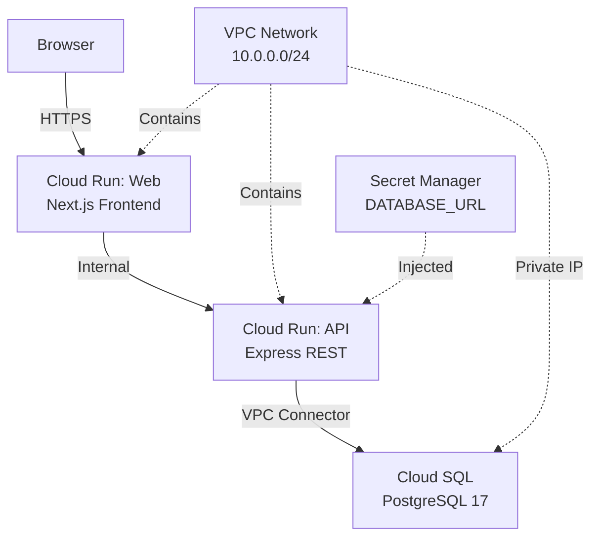

# Deployment to GCP

_Generated by Forge from `main` at `9e9f20c`._

# Deployment to GCP

This application deploys to Google Cloud Platform using Terraform, which provisions a complete infrastructure stack: Cloud Run services for the frontend and API, a managed Cloud SQL PostgreSQL database, VPC networking for security, and IAM resources for access control. The Terraform code in `src/infrastructure/` is environment-aware, supporting dev, staging, and production deployments with appropriate scaling and backup policies.

## Architecture Overview



The deployment uses a private VPC to isolate the database, with Cloud Run services connected via a VPC Access Connector. The web service is publicly accessible; the API is internal-only and invoked by the web service.

## Prerequisites

- **GCP Project**: An active Google Cloud project with billing enabled
- **Terraform**: Version 1.5 or later
- **gcloud CLI**: Authenticated with `gcloud auth application-default login`
- **Container images**: Built and pushed to Google Container Registry (GCR)

## Building and Pushing Container Images

Before deploying, build the Docker images and push them to GCR:

```bash
# Set your GCP project ID
export PROJECT_ID="my-gcp-project-id"

# Build and push the API image
docker build -t gcr.io/$PROJECT_ID/api:latest ./src/api
docker push gcr.io/$PROJECT_ID/api:latest

# Build and push the web image
docker build -t gcr.io/$PROJECT_ID/web:latest ./src/web
docker push gcr.io/$PROJECT_ID/web:latest
```

## Terraform Configuration

### Variables

The deployment is controlled by variables defined in `src/infrastructure/variables.tf`. Key variables:

| Variable | Type | Default | Description |
|----------|------|---------|-------------|
| `project_id` | string | — | GCP project ID (required) |
| `region` | string | `us-central1` | GCP region for all resources |
| `environment` | string | `dev` | Deployment environment: `dev`, `staging`, or `prod` |
| `api_image` | string | — | Container image URI for the API (required) |
| `web_image` | string | — | Container image URI for the web frontend (required) |
| `db_tier` | string | `db-f1-micro` | Cloud SQL machine tier |
| `api_max_instances` | number | 10 | Max Cloud Run instances for API |
| `web_max_instances` | number | 10 | Max Cloud Run instances for web |
| `subnet_cidr` | string | `10.0.0.0/24` | VPC subnet CIDR range |
| `connector_cidr` | string | `10.0.1.0/28` | VPC Access Connector CIDR range |

### Configuration File

Create `src/infrastructure/terraform.tfvars` from the example:

```bash
cp src/infrastructure/terraform.tfvars.example src/infrastructure/terraform.tfvars
```

Edit `terraform.tfvars` with your values:

```hcl
project_id  = "my-gcp-project-id"
region      = "us-central1"
environment = "dev"
api_image   = "gcr.io/my-gcp-project-id/api:latest"
web_image   = "gcr.io/my-gcp-project-id/web:latest"
db_tier     = "db-f1-micro"
```

**Important**: Never commit `terraform.tfvars` to version control—it contains sensitive configuration.

## Deployment Steps

### 1. Initialize Terraform

```bash
cd src/infrastructure
terraform init \
  -backend-config="bucket=my-terraform-state-bucket" \
  -backend-config="prefix=three-tier-app/dev"
```

This configures the GCS backend for storing Terraform state. Create the GCS bucket beforehand:

```bash
gsutil mb gs://my-terraform-state-bucket
```

### 2. Plan the Deployment

```bash
terraform plan -out=tfplan
```

Review the resources that will be created. This includes:
- VPC network and subnet
- Cloud SQL PostgreSQL instance
- Cloud Run services (API and web)
- Service accounts and IAM bindings
- Secret Manager secret for the database URL

### 3. Apply the Configuration

```bash
terraform apply tfplan
```

Terraform will provision all resources. This typically takes 5–10 minutes.

### 4. Retrieve the Web URL

```bash
terraform output web_url
```

This outputs the public URL of the web frontend. Open it in your browser to verify the deployment.

## Infrastructure Components

### VPC Network

`src/infrastructure/main.tf` creates a custom VPC with:
- **Network**: `{app_name}-{environment}-vpc`
- **Subnet**: `{app_name}-{environment}-subnet` with CIDR `10.0.0.0/24`
- **VPC Access Connector**: Enables Cloud Run to reach the VPC and Cloud SQL

### Cloud SQL

A managed PostgreSQL 17 instance with:
- **Private IP only**: No public IP; accessible only from the VPC
- **Automatic backups**: Enabled in production, disabled in dev/staging
- **High availability**: Regional in production, zonal in dev/staging
- **Database**: `app` with user `app` and auto-generated password
- **Connection pooling**: Max 100 connections

The database URL is stored in Secret Manager and injected into Cloud Run services as an environment variable.

### Cloud Run Services

#### API Service

- **Image**: Specified by `api_image` variable
- **Port**: 3001
- **Ingress**: Internal Load Balancer (only accessible from the web service)
- **Scaling**: Min 0 instances (dev/staging) or 1 (prod); max configurable
- **Environment**: `DATABASE_URL` (from Secret Manager), `PORT=3001`
- **Health checks**: Startup probe on `/health`, liveness probe every 30 seconds

#### Web Service

- **Image**: Specified by `web_image` variable
- **Port**: 3000
- **Ingress**: All traffic (publicly accessible)
- **Scaling**: Min 0 instances (dev/staging) or 1 (prod); max configurable
- **Environment**: `PORT=3000`, `API_URL` (set to the API service URI)
- **Health checks**: Startup probe on `/` every 5 seconds

### Service Accounts and IAM

A single service account `{app_name}-{environment}-run` is used by both Cloud Run services with permissions to:
- Access Cloud SQL as a client (`roles/cloudsql.client`)
- Read the database URL secret from Secret Manager (`roles/secretmanager.secretAccessor`)

The web service is publicly invokable; the API is invokable only by the service account.

## Environment-Specific Behavior

The Terraform configuration adapts based on the `environment` variable:

| Setting | Dev | Staging | Prod |
|---------|-----|---------|------|
| Cloud SQL HA | Zonal | Zonal | Regional |
| Cloud SQL backups | Disabled | Disabled | Enabled (03:00 UTC) |
| Cloud SQL deletion protection | No | No | Yes |
| Cloud Run min instances | 0 | 0 | 1 |

## Outputs

After `terraform apply`, retrieve deployment details:

```bash
terraform output web_url      # Public URL of the web frontend
terraform output api_url      # Internal URL of the API service
terraform output db_instance  # Cloud SQL instance name
```

## Destroying Resources

To tear down the deployment:

```bash
terraform destroy
```

**Warning**: In production, Cloud SQL has deletion protection enabled. You must manually disable it in the GCP console before destroying.

## Troubleshooting

### Cloud Run service fails to start

Check logs:

```bash
gcloud run logs read {app_name}-{environment}-api --region=us-central1 --limit=50
```

Common issues:
- **DATABASE_URL not found**: Verify the secret exists in Secret Manager
- **Connection timeout**: Ensure the VPC Access Connector is healthy and the Cloud SQL instance is running
- **Port mismatch**: Verify the container listens on the port specified in the Terraform configuration

### Terraform state lock

If Terraform is stuck, check for locks:

```bash
gsutil ls gs://my-terraform-state-bucket/three-tier-app/dev/
```

### Database connection refused

Verify the Cloud SQL instance is running and the VPC Access Connector can reach it:

```bash
gcloud sql instances describe {app_name}-{environment}-postgres
gcloud compute networks vpc-access connectors describe {app_name}-{environment}-connector --region=us-central1
```

## Sources
- `README.md`
- `src/infrastructure/main.tf`
- `src/infrastructure/variables.tf`
- `src/infrastructure/terraform.tfvars.example`
