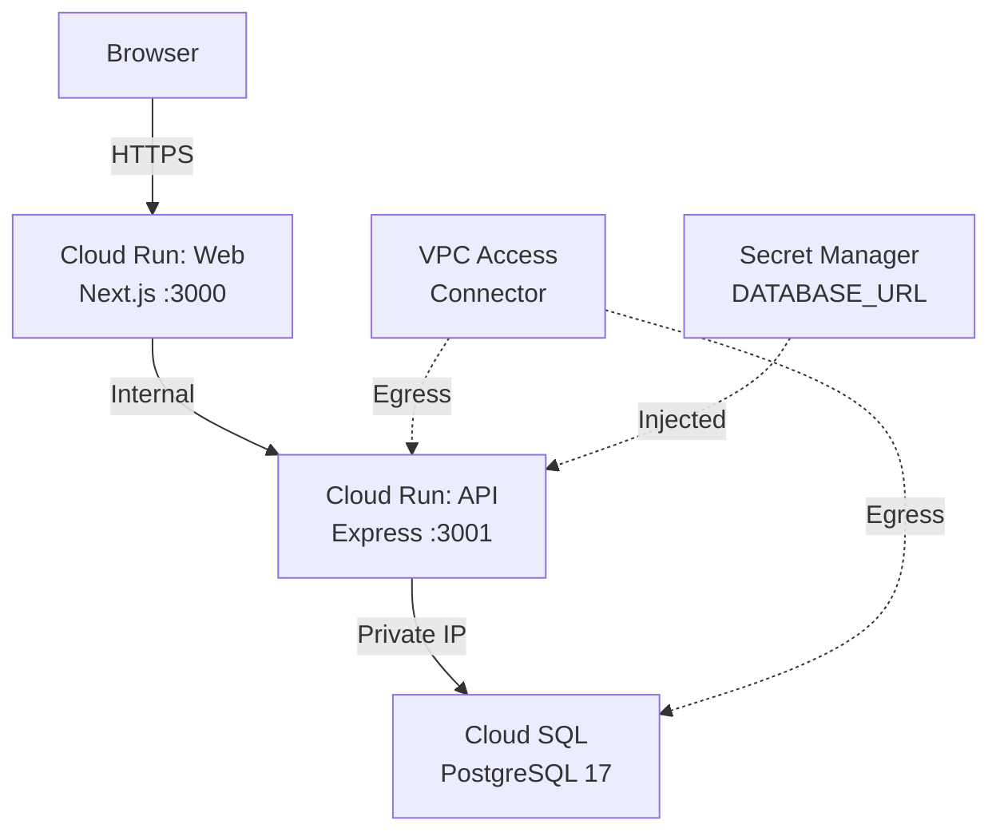

# Deployment to GCP

_Generated by Forge from `main` at `9e9f20c`._

# Deployment to GCP

This application deploys to Google Cloud Platform using Terraform, which provisions a complete three-tier infrastructure: Cloud Run services for the frontend and API, Cloud SQL for the database, and a VPC network with private connectivity. The Terraform configuration in `src/infrastructure/` handles all resource creation, networking, and IAM bindings.

## Architecture Overview



The web service is publicly accessible; the API is internal-only and accessed by the web service. Both services connect to the database through a private VPC network, and the database URL is injected as a secret at runtime.

## Prerequisites

- **GCP Project**: Create a project in the [Google Cloud Console](https://console.cloud.google.com/)
- **Terraform**: Install [Terraform 1.5+](https://www.terraform.io/downloads)
- **gcloud CLI**: Install [Google Cloud SDK](https://cloud.google.com/sdk/docs/install)
- **Docker**: Build and push container images to Google Container Registry (GCR)
- **Permissions**: Your GCP user must have `Editor` or equivalent IAM role

## Building and Pushing Container Images

Before deploying with Terraform, build the Docker images and push them to GCR:

```bash
# Set your GCP project ID
export PROJECT_ID="my-gcp-project-id"

# Build and push the API image
docker build -t gcr.io/$PROJECT_ID/api:latest ./src/api
docker push gcr.io/$PROJECT_ID/api:latest

# Build and push the web image
docker build -t gcr.io/$PROJECT_ID/web:latest ./src/web
docker push gcr.io/$PROJECT_ID/web:latest
```

Ensure you are authenticated with GCR:

```bash
gcloud auth configure-docker
```

## Terraform Configuration

### File Structure

| File | Purpose |
|------|---------|
| `src/infrastructure/main.tf` | VPC, Cloud SQL, Cloud Run, IAM, and Secret Manager resources |
| `src/infrastructure/variables.tf` | Input variables with defaults |
| `src/infrastructure/outputs.tf` | Output values (web URL, API URL, etc.) |
| `src/infrastructure/terraform.tfvars.example` | Example variable values |

### Required Variables

Create a `terraform.tfvars` file in `src/infrastructure/` (never commit this file):

```hcl
project_id  = "my-gcp-project-id"
region      = "us-central1"
app_name    = "todo"
environment = "dev"  # or "staging", "prod"

db_tier     = "db-f1-micro"  # use db-g1-small or db-custom-* for prod
api_image   = "gcr.io/my-gcp-project-id/api:latest"
web_image   = "gcr.io/my-gcp-project-id/web:latest"
```

See `src/infrastructure/terraform.tfvars.example` for all available options.

### Key Configuration Details

**Environment-Specific Behavior:**
- **dev/staging**: Cloud SQL is zonal, backups disabled, Cloud Run min instances = 0 (scales to zero)
- **prod**: Cloud SQL is regional with automated backups, deletion protection enabled, min instances = 1

**Networking:**
- VPC with private subnet (default: `10.0.0.0/24`)
- VPC Access Connector for Cloud Run to reach the VPC
- Cloud SQL private IP only (no public IP)
- Service networking peering for private services access

**Security:**
- Database password auto-generated and stored in Secret Manager
- Cloud Run service account with minimal IAM roles
- Web service publicly accessible; API internal-only
- Database URL injected as a secret environment variable

## Deployment Steps

### 1. Initialize Terraform

```bash
cd src/infrastructure

# Configure the GCS backend for state storage (optional but recommended)
terraform init \
  -backend-config="bucket=my-terraform-state-bucket" \
  -backend-config="prefix=three-tier-app"

# Or use local state (not recommended for production)
terraform init
```

### 2. Plan the Deployment

```bash
terraform plan -out=tfplan
```

Review the output to verify all resources will be created correctly.

### 3. Apply the Configuration

```bash
terraform apply tfplan
```

This will:
- Create the VPC and subnet
- Provision Cloud SQL PostgreSQL 17 instance
- Create Cloud Run services for API and web
- Set up Secret Manager and IAM bindings
- Run database migrations (via `src/infrastructure/migration.tf`)

### 4. Retrieve the Web URL

```bash
terraform output web_url
```

Open this URL in your browser to access the deployed application.

## Database Migrations

Migrations are automatically applied during Terraform deployment via a Cloud Run job defined in `src/infrastructure/migration.tf`. The job runs `node-pg-migrate up` against the Cloud SQL database.

To manually run migrations after deployment:

```bash
# Get the database URL from Secret Manager
gcloud secrets versions access latest --secret="todo-dev-db-url"

# Run migrations locally (requires DATABASE_URL environment variable)
cd src/db
DATABASE_URL="postgres://..." npx node-pg-migrate up
```

## Monitoring and Troubleshooting

### View Cloud Run Logs

```bash
# API service logs
gcloud run logs read todo-dev-api --region=us-central1 --limit=50

# Web service logs
gcloud run logs read todo-dev-web --region=us-central1 --limit=50
```

### Check Cloud SQL Status

```bash
gcloud sql instances describe todo-dev-postgres --region=us-central1
```

### Verify Network Connectivity

The VPC Access Connector must be healthy for Cloud Run to reach Cloud SQL:

```bash
gcloud compute networks vpc-access connectors describe todo-dev-connector \
  --region=us-central1
```

## Scaling and Performance

### Cloud Run Scaling

Adjust max instances in `terraform.tfvars`:

```hcl
api_max_instances = 20   # default: 10
web_max_instances = 20   # default: 10
```

### Cloud SQL Scaling

Change the machine tier:

```hcl
db_tier = "db-g1-small"  # or db-custom-4-16384 for custom CPU/memory
```

Disk auto-resizes automatically; backups are enabled in production.

## Cleanup

To destroy all resources and avoid ongoing charges:

```bash
cd src/infrastructure
terraform destroy
```

**Warning**: This will delete the Cloud SQL database and all data. In production, deletion protection prevents accidental destruction.

## Outputs

After `terraform apply`, retrieve deployment details:

```bash
terraform output web_url      # Public URL of the web frontend
terraform output api_url      # Internal URL of the API
terraform output db_instance  # Cloud SQL instance name
```

## Sources
- `README.md`
- `src/infrastructure/main.tf`
- `src/infrastructure/variables.tf`
- `src/infrastructure/terraform.tfvars.example`
