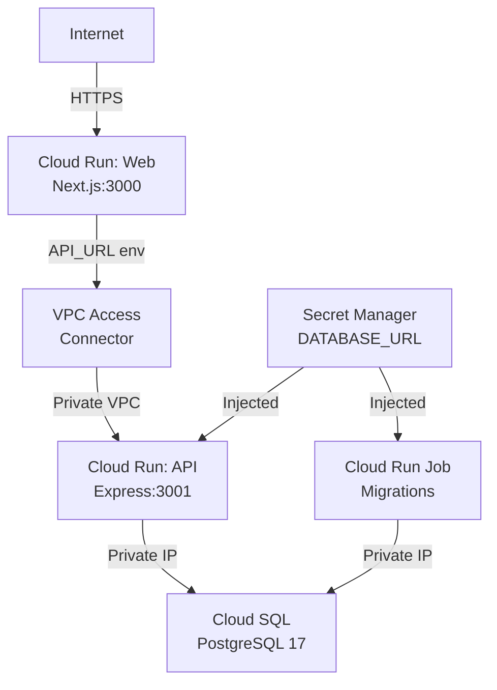

# Deployment to GCP

_Generated by Forge from `main` at `9e9f20c`._

This application deploys to Google Cloud Platform using Terraform, which provisions a complete infrastructure stack: a VPC network with Cloud SQL PostgreSQL, two Cloud Run services (API and web frontend), and Secret Manager for secure credential storage. The Terraform configuration in `src/infrastructure/` handles all networking, database setup, and service deployment with environment-specific settings for dev, staging, and production.

## Prerequisites

- **GCP Project**: Create a project in the [Google Cloud Console](https://console.cloud.google.com/)
- **Terraform**: Install [Terraform](https://www.terraform.io/downloads) (>= 1.5)
- **gcloud CLI**: Install the [Google Cloud SDK](https://cloud.google.com/sdk/docs/install)
- **Docker**: Build and push container images to Google Container Registry (GCR)
- **GCS Bucket**: Create a Cloud Storage bucket for Terraform state (recommended)

Authenticate with GCP:
```bash
gcloud auth login
gcloud config set project YOUR_PROJECT_ID
```

## Build and Push Container Images

Before deploying, build the API, web, and database migration images and push them to GCR:

```bash
PROJECT_ID=my-gcp-project-id

docker build -t gcr.io/$PROJECT_ID/api:latest ./src/api
docker build -t gcr.io/$PROJECT_ID/web:latest ./src/web
docker build -t gcr.io/$PROJECT_ID/db:latest ./src/db

docker push gcr.io/$PROJECT_ID/api:latest
docker push gcr.io/$PROJECT_ID/web:latest
docker push gcr.io/$PROJECT_ID/db:latest
```

## Terraform Configuration

### Variables

The deployment is configured via `src/infrastructure/variables.tf`. Key variables:

| Variable | Type | Default | Description |
|----------|------|---------|-------------|
| `project_id` | string | — | GCP project ID (required) |
| `region` | string | `us-central1` | GCP region for all resources |
| `app_name` | string | `todo` | Application name prefix for resource names |
| `environment` | string | `dev` | Deployment environment: `dev`, `staging`, or `prod` |
| `db_tier` | string | `db-f1-micro` | Cloud SQL machine tier |
| `api_image` | string | — | Container image URI for the API (required) |
| `web_image` | string | — | Container image URI for the web frontend (required) |
| `api_max_instances` | number | `10` | Max Cloud Run instances for API |
| `web_max_instances` | number | `10` | Max Cloud Run instances for web |

### Create terraform.tfvars

Copy `src/infrastructure/terraform.tfvars.example` to `terraform.tfvars` and fill in your values:

```bash
cd src/infrastructure
cp terraform.tfvars.example terraform.tfvars
# Edit terraform.tfvars with your project_id, region, and image URIs
```

Example `terraform.tfvars`:
```hcl
project_id  = "my-gcp-project-id"
region      = "us-central1"
app_name    = "todo"
environment = "dev"
db_tier     = "db-f1-micro"
api_image   = "gcr.io/my-gcp-project-id/api:latest"
web_image   = "gcr.io/my-gcp-project-id/web:latest"
```

## Initialize and Deploy

### Initialize Terraform

```bash
cd src/infrastructure
terraform init
```

To use a GCS backend for state (recommended for team environments):
```bash
terraform init \
  -backend-config="bucket=my-terraform-state-bucket" \
  -backend-config="prefix=three-tier-app/dev"
```

### Plan and Apply

Review the infrastructure plan:
```bash
terraform plan
```

Deploy the infrastructure:
```bash
terraform apply
```

Terraform will create:
- VPC network and subnet
- VPC Access Connector (for Cloud Run to reach the VPC)
- Cloud SQL PostgreSQL 17 instance (private IP, no public access)
- Cloud Run service for the API (internal ingress only)
- Cloud Run service for the web frontend (public ingress)
- Secret Manager secret for the database URL
- Service accounts and IAM bindings

## Infrastructure Architecture



## Database Migrations

After deployment, run database migrations using a Cloud Run Job. The `src/infrastructure/migration.tf` file defines a one-time job that applies pending migrations:

```bash
terraform apply -target=google_cloud_run_v2_job.migrate
```

Or manually trigger migrations via the Cloud Run Jobs UI in the GCP Console.

## Outputs

After `terraform apply`, retrieve deployment information:

```bash
terraform output web_url      # Public URL of the web frontend
terraform output api_url      # Internal URL of the API
terraform output db_instance  # Cloud SQL instance name
```

The web frontend is publicly accessible at the `web_url` output. The API is only reachable from within the VPC (via the web service or VPC Access Connector).

## Environment-Specific Settings

The Terraform configuration adapts based on the `environment` variable:

| Setting | Dev | Staging | Prod |
|---------|-----|---------|------|
| Cloud SQL availability | ZONAL | ZONAL | REGIONAL |
| Cloud SQL backups | Disabled | Disabled | Enabled (03:00 UTC) |
| Cloud SQL deletion protection | No | No | Yes |
| Cloud Run min instances | 0 (scale to zero) | 0 | 1 (always running) |

For production deployments, use `environment = "prod"` and a larger `db_tier` (e.g., `db-g1-small` or `db-custom-4-16384`).

## Cleanup

To destroy all GCP resources:

```bash
cd src/infrastructure
terraform destroy
```

**Warning**: This will delete the Cloud SQL database and all data. For production, Cloud SQL has deletion protection enabled.

## Troubleshooting

**Cloud Run service fails to start**: Check logs in the Cloud Run console or via:
```bash
gcloud run logs read SERVICE_NAME --region=REGION --limit=50
```

**API cannot reach database**: Verify the VPC Access Connector is healthy and the service account has `roles/cloudsql.client` IAM binding.

**Migrations don't run**: Ensure the database image is pushed to GCR and the Cloud Run Job has the correct image URI and `DATABASE_URL` secret access.

## Sources
- `README.md`
- `src/infrastructure/variables.tf`
- `src/infrastructure/main.tf`
- `src/infrastructure/terraform.tfvars.example`
