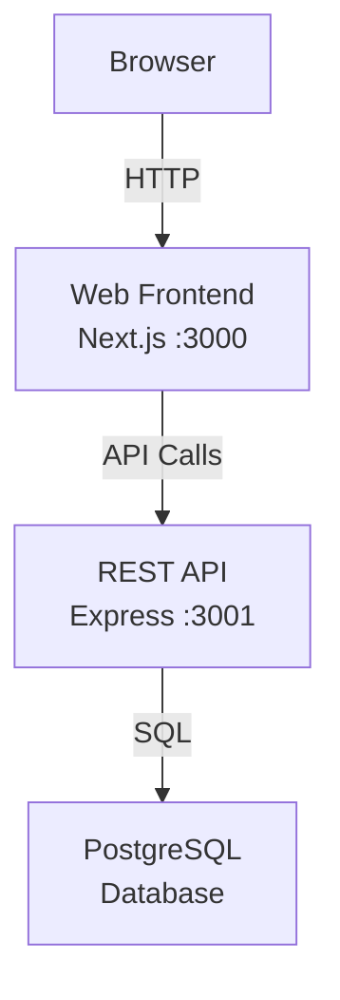

# Overview

_Generated by Forge from `main` at `76d22b1`._

Perfect! I have all the information I need from the README. Now I'll write the Overview page for the wiki.

---

This is a three-tier task manager application that demonstrates a modern full-stack architecture with a Next.js frontend, Express REST API, and PostgreSQL database. The entire stack runs locally with Docker Compose and deploys to Google Cloud Platform using Terraform, making it an ideal reference implementation for learning cloud-native development patterns.

## What is this project?

The three-tier application demo is a simple to-do list application built to showcase how frontend, backend, and database layers communicate in a production-like environment. It serves as a learning resource for developers interested in understanding:

- Full-stack JavaScript development (Next.js + Node.js)
- REST API design with Express
- Database schema management with migrations
- Infrastructure-as-code deployment to GCP
- Containerized local development with Docker Compose

## Technology Stack

| Layer | Technology | Location |
|-------|-----------|----------|
| Frontend | Next.js 16, React 19, Tailwind CSS | `src/web/` |
| API | Express 5, Node.js 22 | `src/api/` |
| Database | PostgreSQL 17 | managed by Docker / Cloud SQL |
| Migrations | node-pg-migrate | `src/db/` |
| Infrastructure | Terraform (GCP) | `src/infrastructure/` |

## Key Features

- **Local development** — Start the entire stack with a single `docker compose up` command
- **Database migrations** — Schema changes managed with node-pg-migrate, applied automatically on startup
- **REST API** — Simple endpoints for task management (list, create, update)
- **Cloud deployment** — Terraform provisions Cloud Run services and Cloud SQL on GCP
- **Containerized** — Each tier (web, API, database) runs in its own Docker container

## Architecture Overview



## Quick Start

To run the application locally:

```bash
docker compose up --build
```

This starts four services:
1. **postgres** — PostgreSQL 17 database
2. **migrate** — Applies database schema migrations
3. **api** — Express API (internal only)
4. **web** — Next.js frontend on [http://localhost:3000](http://localhost:3000)

See the "Getting Started" page for detailed setup instructions.

## Core Functionality

The application implements a basic task manager with the following operations:

- **List tasks** — Retrieve all tasks from the database
- **Create task** — Add a new task with a title
- **Update task** — Mark tasks as complete or edit their title

The API exposes these operations via REST endpoints documented in the "API Endpoints" page.

## Deployment

The project includes production-ready infrastructure code in `src/infrastructure/` that deploys to Google Cloud Platform with:

- VPC network and private Cloud SQL instance
- Cloud Run services for the API and frontend
- Secret Manager for sensitive configuration
- Proper IAM bindings and service accounts

See the "Deployment to GCP" page for step-by-step deployment instructions.

## Sources
- `README.md`
