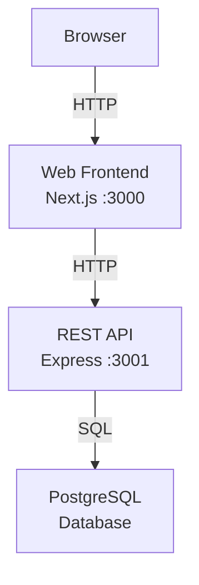

# Overview

_Generated by Forge from `main` at `066e1ef`._

# Overview

This is a reference implementation of a three-tier web application demonstrating how to build, run, and deploy a modern full-stack system. The application is a simple task manager (to-do list) that showcases communication between a Next.js frontend, an Express REST API, and a PostgreSQL database. It runs locally with Docker Compose and deploys to Google Cloud Platform via Terraform.

## What is a Three-Tier Application?

A three-tier architecture separates an application into three logical layers:

| Layer | Purpose | Technology |
|-------|---------|-----------|
| **Presentation** | User interface and client-side logic | Next.js 16, React 19, Tailwind CSS |
| **Application** | Business logic and API endpoints | Express 5, Node.js 22 |
| **Data** | Persistent storage | PostgreSQL 17 |

This separation enables independent scaling, easier testing, and clearer responsibility boundaries.

## Architecture Overview



The application flow is straightforward: users interact with the Next.js frontend in their browser, which communicates with the Express API, which queries the PostgreSQL database.

## Project Structure

The codebase is organized by layer in `src/`:

- **`src/web/`** — Next.js frontend with App Router pages and components
- **`src/api/`** — Express REST API with route handlers and database connection pool
- **`src/db/`** — Database migrations using node-pg-migrate
- **`src/infrastructure/`** — Terraform configuration for GCP deployment

## Key Features

- **Local development** with Docker Compose (`docker-compose.yml`) — all services start with a single command
- **Automated database migrations** — schema is applied automatically on startup
- **RESTful API** — standard HTTP endpoints for task management
- **Infrastructure as Code** — Terraform provisions Cloud Run, Cloud SQL, and networking on GCP
- **Production-ready** — includes health checks, service dependencies, and proper error handling

## Getting Started

To run the application locally:

```bash
docker compose up --build
```

Then open [http://localhost:3000](http://localhost:3000) in your browser.

The application will automatically:
1. Start a PostgreSQL database
2. Run database migrations
3. Start the Express API
4. Start the Next.js frontend

For detailed setup instructions, see the [Getting Started](Getting-Started) page.

## Sources
- `README.md`
- `docker-compose.yml`
