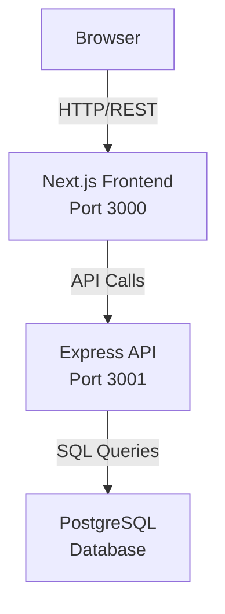

# Overview

_Generated by Forge from `main` at `9e9f20c`._

# Overview

This is a reference implementation of a three-tier web application demonstrating modern full-stack development practices. It combines a Next.js frontend, an Express REST API, and a PostgreSQL database to build a simple task manager (to-do list). The application runs locally with Docker Compose and deploys to Google Cloud Platform via Terraform, showcasing how to structure, develop, and deploy a production-ready web application.

## What is a three-tier application?

A three-tier architecture separates an application into three logical layers:

| Layer | Purpose | Technology |
|-------|---------|-----------|
| **Presentation** | User interface and client-side logic | Next.js 16, React 19, Tailwind CSS |
| **Application** | Business logic and API endpoints | Express 5, Node.js 22 |
| **Data** | Persistent storage and schema | PostgreSQL 17 |

This separation enables independent scaling, testing, and deployment of each layer.

## Architecture overview



The data flow is unidirectional: the browser communicates with the frontend, which calls the API, which queries the database. This clean separation ensures each layer has a single responsibility.

## Project structure

The codebase is organized in `src/` with four main directories:

- **`src/web/`** — Next.js frontend application with App Router pages and React components
- **`src/api/`** — Express REST API with route handlers and database connection pool
- **`src/db/`** — Database migrations using node-pg-migrate
- **`src/infrastructure/`** — Terraform configuration for GCP deployment (Cloud Run + Cloud SQL)

## Key features

- **Local development** — Start the entire stack with `docker compose up --build`
- **Database migrations** — Automated schema management with node-pg-migrate
- **REST API** — Simple endpoints for task CRUD operations
- **Cloud deployment** — Infrastructure-as-code with Terraform for GCP
- **Service orchestration** — Docker Compose manages startup order and health checks

## Getting started

To run the application locally, you need Docker Desktop. Start all services with:

```bash
docker compose up --build
```

This launches PostgreSQL, runs migrations, starts the API, and finally the frontend. Open [http://localhost:3000](http://localhost:3000) to access the application.

For detailed setup instructions, deployment steps, and API documentation, see the other pages in this wiki.

## Sources
- `README.md`
- `docker-compose.yml`
